# SinoBee 🐝

**Open Source Swarm Intelligence Agents** — 你用一句話交代任務，SinoBee 就在電腦上幫你完成。

它會自己上網查資料、讀檔案、寫程式、跑指令、操作瀏覽器與滑鼠鍵盤，做完把結果整理成表格、圖表與檔案交給你；危險的操作會先問你，做得好不好你說了算，它會記住並越用越順手。可以接任何主流 AI 模型（OpenAI、Anthropic、Gemini…），也可以直接在你的電腦上跑開放模型，免金鑰、免費、資料不出門。

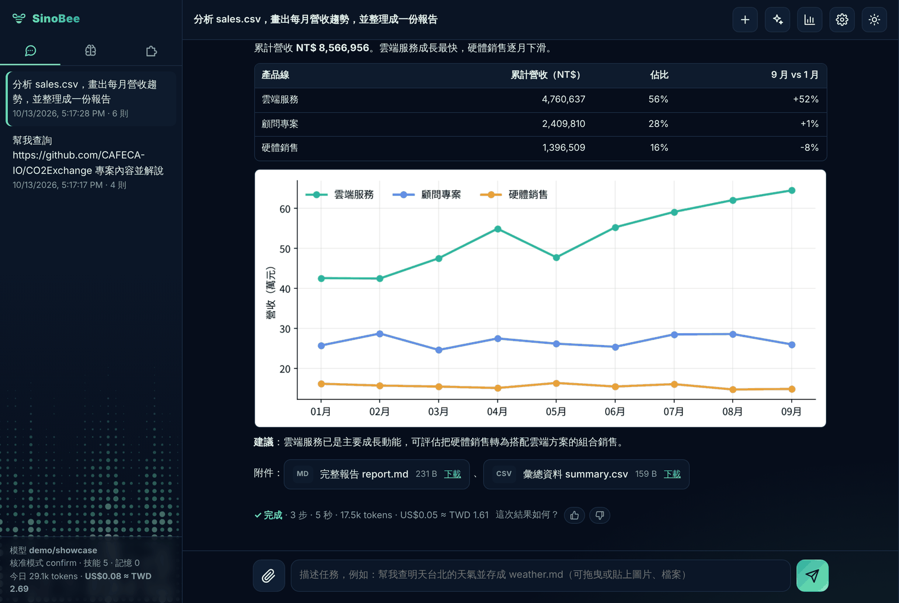

- [它能做什麼](#它能做什麼)
- [開始使用](#開始使用)
- [日常使用技巧](#日常使用技巧)
- [管理：用量、技能、權限](#管理用量技能權限)
- [進階設定與指令](#進階設定與指令)

## 它能做什麼

SinoBee 有六種工作模式，交代一句話就開工，做完把成果交給你：

| 工作模式 | 適合做什麼 | 對應段落 |
|---|---|---|
| 研究調查 | 查資料、比對來源、分析檔案，整理成附引用的報告與圖表 | [1](#1-查資料並講給你聽)、[2](#2-分析資料畫圖產出報告) |
| 長期追蹤 | 定期追蹤指定主題，每期整理變化與影響，需要時產出專題報告 | [9](#9-背景工作排程持續追蹤固定流程)、[11](#11-定期追蹤指定主題的知識情報) |
| 外部設備操作 | 操作瀏覽器、桌面軟體、檔案、資料庫與遠端主機 | [3](#3-整理你電腦裡的檔案)、[8](#8-搬移資料庫)、[還可以](#還可以) |
| 知識學習與研究 | 從文件、網址與每次任務的經驗學習，自動更新記憶與技能 | [6](#6-自動學習知識庫越用越完整) |
| 大型專案開發 | 大任務拆成里程碑、子代理並行、寫程式與跑測試，中斷可續跑 | [大型任務](docs/LARGE_TASKS.md)、[還可以](#還可以) |
| 影片製作 | 一句話完成腳本、配音、分鏡、渲染、剪接與字幕 | [10](#10-一句話做出-ai-影片) |

以下截圖都是 SinoBee 的實際畫面，工具（下載網頁、執行指令、搬移檔案、產生圖表）都是真的執行；為了截圖重現，模型的回覆由示範腳本提供，資料為示範用。

### 1. 查資料並講給你聽

> 幫我查詢 https://github.com/CAFECA-IO/CO2Exchange 專案內容並解說

SinoBee 讀取專案文件，整理出「這是什麼」、核心概念表、流程圖、技術重點與如何在本機跑起來。網頁、新聞、文件、GitHub 專案都適用，也可以要求它比較多個來源、附上出處。

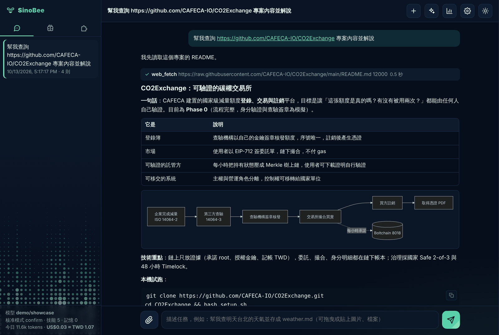

### 2. 分析資料、畫圖、產出報告

> 分析 sales.csv，畫出每月營收趨勢，並整理成一份報告

它先看資料欄位，再寫 Python 彙總與畫圖，最後給你結論、表格、趨勢圖，以及可以直接下載的報告與彙總檔（見本頁最上方的截圖）。Excel、CSV、日誌、資料庫匯出檔都能這樣處理。

### 3. 整理你電腦裡的檔案

> 幫我整理 downloads 資料夾，依檔案類型分類

它列出檔案、依類型建立資料夾並搬移（不覆蓋同名檔案），最後回報每個資料夾放了幾個檔案。改檔名、轉檔、批次處理也一樣。

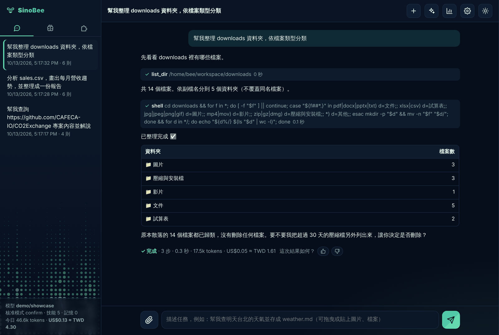

### 4. 危險的操作會先問你

> 好，刪除 downloads 裡的「壓縮與安裝檔」資料夾

刪除檔案、安裝軟體、取得管理員權限、強制推送 git 等操作，會跳出核准視窗，清楚列出它要執行的指令，你按「允許」才會做。

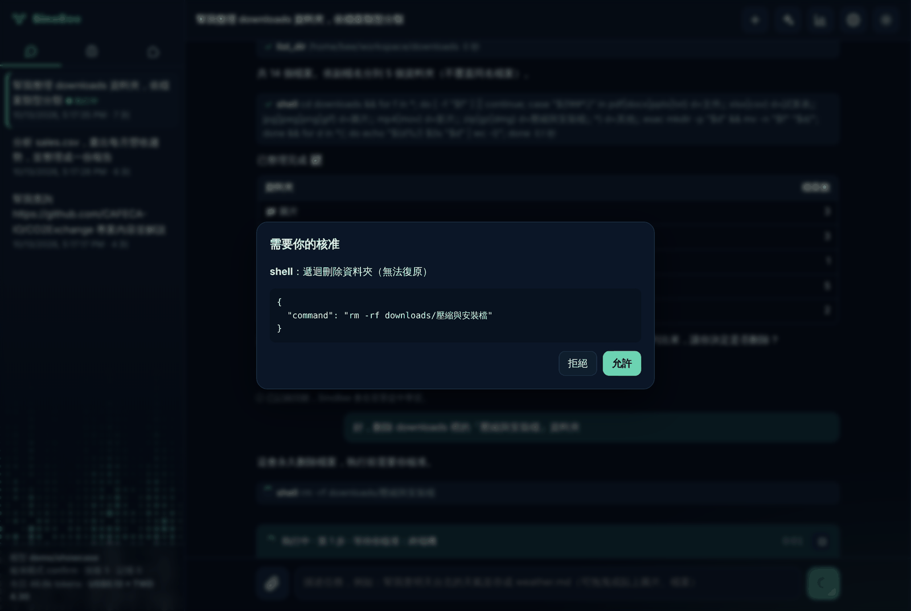

### 5. 隨時知道它在做什麼

任務進行中，輸入框上方會顯示目前第幾步、正在用什麼工具、經過多久。

- **過程收合成一行**：每段執行過程（指令、讀寫檔、搜尋、技能…）預設只顯示一行摘要，例如「執行 5 個指令、讀取 3 個檔案（9 步）」，旁邊附上耗時與產出檔案的縮圖或圖示；想看細節再點開，畫面不會被過程洗版。
- **中間產物立即可看**：工具產生的檔案（圖片、影片、報告、試算表、字幕…）會在該步驟下方顯示縮圖、播放器或檔案卡，點開即可預覽或下載；完成時再列出「本次產出」。重新打開對話也看得到。
- **執行中可以插話**：任務跑到一半直接在輸入框補充或修改需求（例如「改成直式 9:16」），按 Enter 送出，會在目前這一步結束後納入，不必重來；按輸入框旁的 ■ 則停止目前任務並改做你剛輸入的要求；上方的停止鍵是單純停止。
- **每輪對話都有執行紀錄**：「工作」頁的現在與過去同時列出對話、排程工作與固定流程。對話紀錄會顯示每個步驟、產出檔案、你的補充與完成檢查結果；被中斷或未完成的可以按「續跑」，在原對話從中斷處接著做。
- **思維模型與執行模型分工**：設定裡分成兩個角色，SinoBee 不會在任務中途自行換模型。
  - **思維模型**：開工前想好做法、步驟與驗收清單；執行卡關時看過整段過程給建議，並判斷還做不做得到；交付前驗收；失敗時診斷原因。它不執行任何步驟。
  - **執行模型**：依計畫執行每一個步驟，從頭做到尾。
  - 思維模型判定執行模型做不到（或給過建議後仍卡住）時，任務標示「✕ 任務失敗」並保存**失敗報告**：計畫、建議、每一步的工具呼叫與結果、品質檢查，以及思維模型的診斷與改進建議（設定 →「品質」或 `sinobee failures`），可以一鍵轉成回歸測試。
- **大型任務分成里程碑執行**：思維模型把大任務拆成里程碑，並定下各部分要共用的事實，例如單位、名稱、關鍵數字。
  - **何時先問你**：需求不明確，或會有子代理並行時，先請你確認或修正；需求明確就直接開始。
  - **乾淨的上下文**：一次做一個里程碑，做完只帶摘要和產出到下一個，長報告不會一直壓縮上下文。
  - **子代理**：獨立的里程碑交給子代理並行；子代理寫回的事實與共享表衝突時，由思維模型裁決。
  - **修正計畫**：執行中可以按「修正計畫」，選擇下個里程碑交界才套用，或立即中斷並重新規劃；已完成的部分都會保留。
  - **中斷後**：從第一個未完成的里程碑接著做。
- **任務預算與部分交付**：依任務類型，用過去同類任務的 p50/p90 估算這次的參考預算；資料不足時改用「估計步數 × 平均每步用量 × 2」。
  - **檢查點**：用到 50% 和 80% 時，思維模型會比對里程碑完成比例並發出提醒，任務不會被打斷。
  - **每個任務的上限**：在「設定 →用量」可調；達到上限時會問你要追加還是停止。
  - **部分交付**：任務因上限或錯誤而中止時，已驗收的里程碑、產出的檔案和剩下的待辦會整理好交給你，之後回覆「繼續」就能接著做。
- **自動適應新模型的參數限制**：遇到新模型不接受的取樣參數（例如 Claude Opus 5.5 不再接受 temperature）時，SinoBee 會自動拿掉它重送，並記住這個模型，任務不會中斷。
- **不設步數上限，看進度決定何時停**：每一步都會判斷有沒有讓任務前進，依據包括：
  - 驗收清單、測試結果、新檔案、文件結構；
  - 只改檔案時可容忍的步數依檔案類型而定，程式碼 8 步、文件 3 步。

  連續 15 步沒有進度，或偵測到原地打轉，就請思維模型判斷；單一代理 300 步是安全閥。每次請教或停止都記下具體的觸發條件、門檻和每步的判斷依據，可在對話中的「觸發依據」、設定 →「品質」→「執行控制紀錄」，或用 `sinobee control-log` 查看；`sinobee progress-replay --last 50` 可用過去的對話重放，檢查這些門檻在你的實際工作上會怎麼判斷。
- **沒有產出就提醒**：驗收清單還沒完成，卻連續 8 步只在查資料、沒有寫出任何檔案時，會請思維模型給建議；預算用到八成仍沒有產出也會請教。這只是提醒，不會中止任務。大型檔案（例如整頁 HTML）會先寫骨架再分段補齊。
- **長回答不再逾時**：模型回答改用串流，寫很長的內容也不會被中間的代理伺服器以 504 切斷。
- **每步花費與任務效率**：每個任務（成功的也算）都會留下執行報告，記錄每一步用了多少 tokens、等模型與執行工具各花了多久、重送了幾次；結果卡片點「每步花費」就能看出哪一步最貴。設定 →「品質」→「任務效率」列出花最多但產出最少的任務。命令列：`sinobee runs`。
- **觀測與調整**：觸發請教時，輔助模型會先看最近的步驟，判斷是真的原地打轉還是有實質進展，結論一併交給思維模型並記入紀錄。每次停止（包括安全閥）都附失敗報告，紀錄中可直接連過去。設定 →「品質」→「觀測」統計請教、安全閥、預算與部分交付事件；「調整建議」依重放結果與實際用量建議 K、各檔案類型的 N 與預算合成係數，資料不足時不給建議，可一鍵套用。命令列：`sinobee observe`、`sinobee tune --apply all`。
- **完成檢查**：多步驟任務結束前，SinoBee 會先確認是否真的完成，沒完成會再做一輪，仍沒完成就標示「未完成」並說明缺什麼。
- 結束後會標示完成、錯誤或未完成，出錯時說明原因與建議怎麼做；最後一步失敗就不會標成完成。重新整理頁面或換一台裝置打開，狀態都還在。

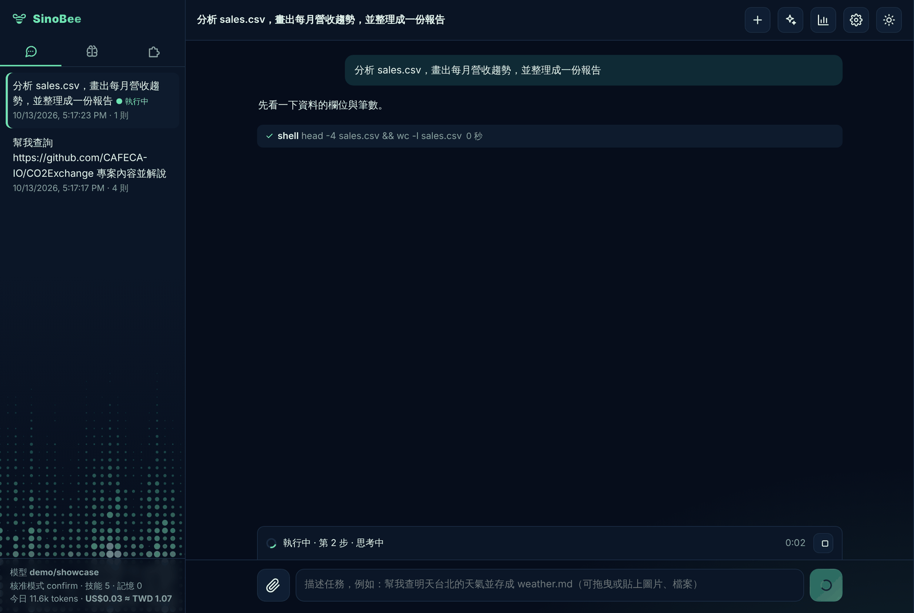

### 6. 自動學習：知識庫越用越完整

SinoBee 的知識庫由兩部分組成：**記憶**（你是誰、你的偏好、做過的事與學到的事實）和**技能**（可重複使用的做法）。兩者都會在工作中自動增加、整理與修正，不用你特別交代。

**從你的回饋學**：每次任務完成後可以按 👍 或 👎，並勾選原因、寫一句建議。SinoBee 會在背景反省這次的做法，把你的偏好記進長期記憶、調整或建立技能，下次就照你要的方式做。

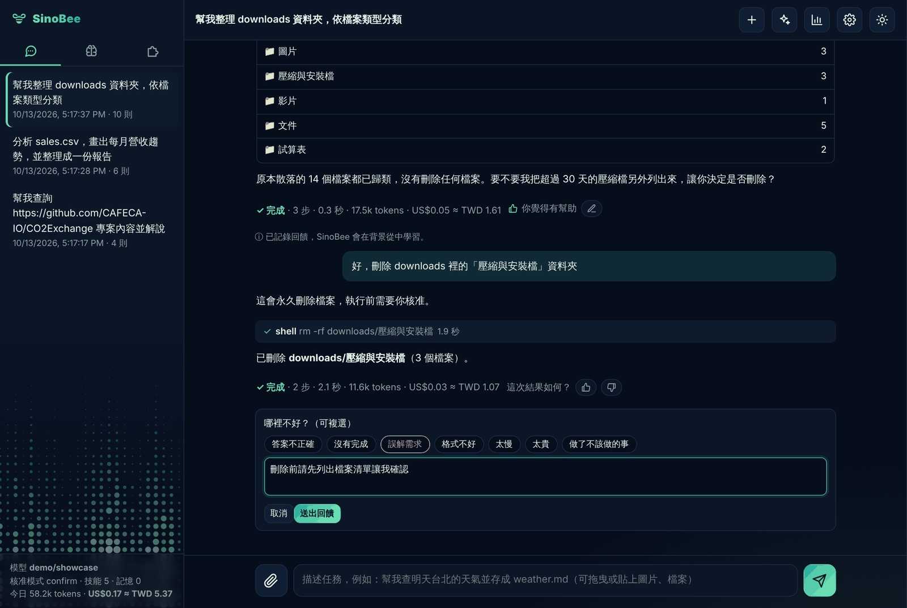

**從資料學**：說「記住這個做法」，或輸入 `/learn <網址｜資料夾｜描述>`，它會讀完內容，把流程寫成可重複使用的技能（符合 [Agent Skills 標準](https://agentskills.io)，可分享給團隊）。

**從經驗學（自動）**：每次任務結束後，SinoBee 會檢查有沒有值得學的地方：

- **遇到缺口**：花了很多步驟、或從錯誤中恢復才完成，卻沒有對應技能 → 把做法寫成新技能；
- **重複出現**：同類任務做過兩次以上 → 優先整理成技能；
- **做錯被糾正**：用到的技能失敗，或你糾正了它 → 修補技能（唯讀的技能另存一份再修）。

自動產生的技能先標成「試用」，成功用過 2 次或經你核准後才正式啟用；之後一再失敗會標成「需要修正」。也可以在設定改成「先問我」或關閉自動建立。

**記憶分四層，自動維護**：

| 層 | 存什麼 | 怎麼更新 |
|---|---|---|
| 任務 | 目前任務的目標、計畫與進度 | 每一步即時更新；太長時自動濃縮，保留所有重點 |
| 短期 | 最近任務學到的事實 | 14 天後檢查：有用過的升為長期，沒用的封存 |
| 長期 | 你的偏好、環境與累積的知識 | 每次對話自動召回相關的幾則；長期沒用會逐漸淡出 |
| 永久 | 你要求它永遠記住的事 | 不會被淘汰、合併或改寫，只有你能刪除 |

- **定期整理**：每 6 小時（以及每天 03:17 的「記憶整理」工作）合併重複、過時的記憶；合併前檢查數字、路徑與網址沒有遺失，原始版本都保留，可以還原。
- **對話快滿也不會忘**：上下文接近模型上限時，被摘要掉的對話會先萃取重點存成短期記憶，之後仍能召回。
- **長期追蹤會累積**：持續性工作每次執行都讀得到上一次的結果與筆記，報告呈現的是「和上次比有什麼變化」（見 [11](#11-定期追蹤指定主題的知識情報)）。

**學得對，也學得安全**：

- 記憶只記事實，不記「做得很成功」這類自我評價，避免下次被自己的說法誤導；
- 從網頁等外部內容學到、會影響所有對話的記憶，要你在「記憶」分頁核准後才會生效，防止網頁夾帶指令；
- 寫進記憶與技能的內容都會檢查是否夾帶提示注入或機密；
- 記憶與技能都可以在左側欄查看、修改與刪除。

### 7. 登錄資料庫工具、分享對話（SinoBee.ai 帳號）

在「設定 → SinoBee.ai 帳號」按「登入」，或執行 `sinobee login`，在瀏覽器確認畫面上的代碼即可（沒有瀏覽器或在 Docker 裡時，用手機掃 QR code）。登入後可以：

- **把資料庫連線做成工具**：
  - 請 SinoBee「把這個連線做成工具」，它會整理資料表說明、常用查詢與一份 SKILL.md，存在 `~/.sinobee/tools/<連線>/`；SQL 編輯區也能直接「儲存查詢」。
  - 終端機或其他 agent 也能用同一組連線（唯讀，密碼不經手）：`sinobee db list`、`sinobee db schema <連線> [資料表]`、`sinobee db query <連線> "SELECT …" --format md|csv|json`。
  - 按上傳圖示登錄到 sinobee.ai，選「私人」或「公開」。**帳號密碼不會上傳**。
  - 公開工具審核後列在 [sinobee.ai/tools](https://sinobee.ai/tools)，可以評分與檢舉。
- **加密保險箱**：私人工具可勾選「加密同步」，連線資料在你的電腦上加密後才上傳。
  - 每台登入的電腦各自保存一份金鑰，平常不必輸入密語。
  - 換新電腦時輸入一次密語，或在舊電腦的設定頁按「授權」即可。
  - 之後用 `sinobee tools install <publisher>/<name>` 就能還原連線。
- **分享對話**：在對話上方按分享圖示，先預覽實際要上傳的內容。
  - 自動遮蔽：金鑰、密碼、權杖與本機路徑。
  - 可另外遮蔽：主機名稱、內網 IP 或自訂字詞。
  - 可以只分享到某一輪；資料庫查詢結果預設只留 20 列。
  - 對話中的圖片、影片與檔案會一起附上，單檔最大 25 MB，總共 100 MB。
  - 分享範圍：
    - 知道連結的人；
    - 需登入，可以只開放給特定的 CAFECA 帳號；
    - 公開。
  - 預設 30 天後到期，可在設定頁更改範圍或撤回。
  - 收到分享的人可以按「在我的 SinoBee 繼續」，或執行 `sinobee share import <連結>`，把對話匯入自己的 SinoBee 接著問。
- **分享報告與互動頁面**：在文件檢視器（技能產生的 Markdown 報告、HTML 頁面）按分享圖示，就能單獨分享這份文件。
  - 報告用到的圖片、頁面用到的樣式、圖片與資料檔會一起上傳，路徑保持不變；文字檔同樣會自動遮蔽。
  - 對話裡連到的報告或頁面也會一起附上，在 sinobee.ai 上點開就能看，互動頁面在隔離的沙箱裡執行。
- **連結預覽**：每個分享都會產生 1200×630 的縮圖和摘要說明，貼到 LINE、Facebook、X、Slack 等平台時會顯示出來。
  - 縮圖：報告用它的封面；互動頁面用頁面本身的截圖；對話用第一張圖或 SinoBee.ai 風格的標題卡。
  - 摘要可以在分享前修改，縮圖也可以不附上。
  - 「需登入」的分享不會對外顯示標題、摘要與縮圖。
- 工具與分享的內容雜湊會寫上 Boltchain 存證，任何人都能用存證代碼驗證內容沒有被改過。

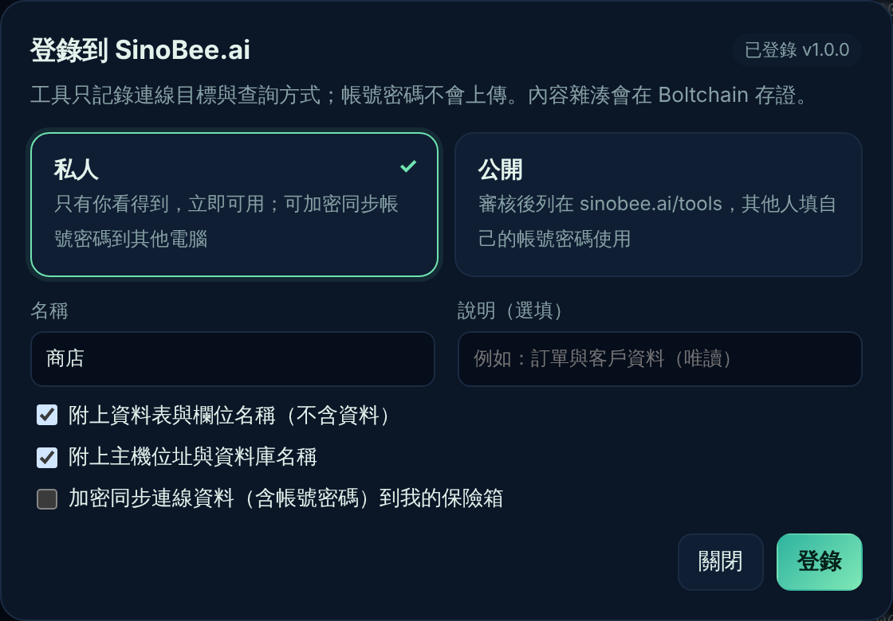

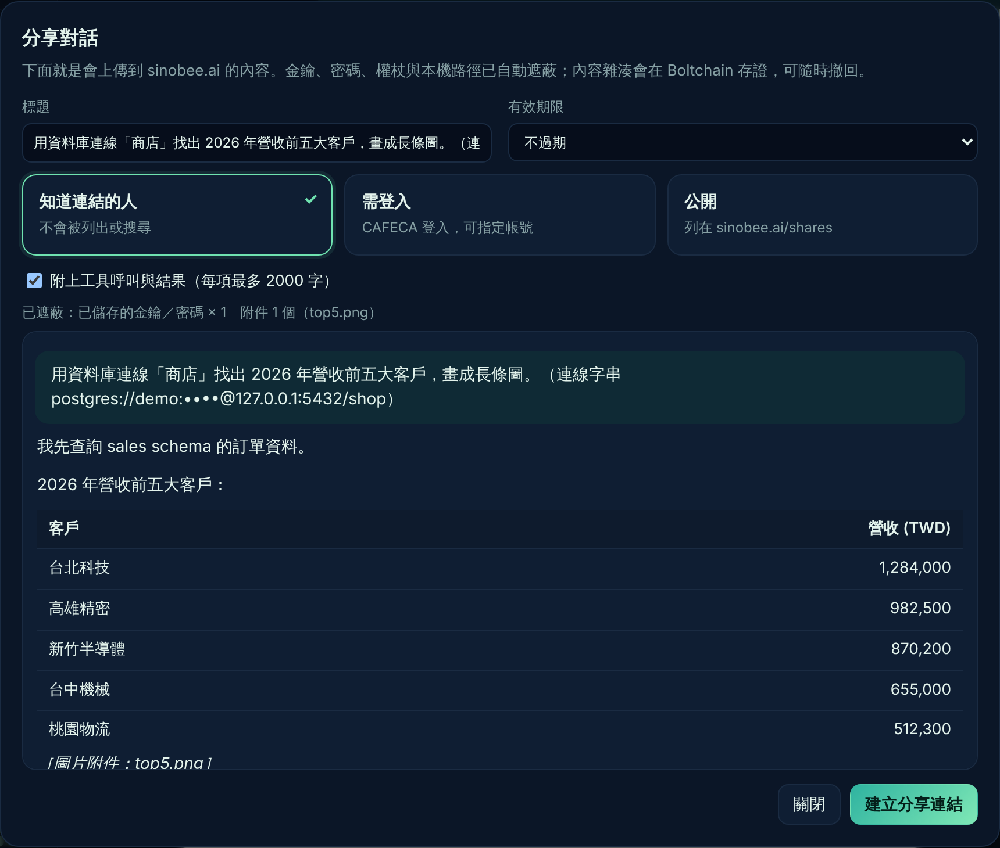

### 8. 搬移資料庫

把整個資料庫（結構＋資料）搬到別的地方，例如把 AWS Aurora / RDS 搬到自架的 MySQL 或 PostgreSQL。

- **目的地**：另一個 MySQL / MariaDB、PostgreSQL、SQLite 資料庫，新的 SQLite 檔，或匯出成 `.sql`（可壓縮成 `.gz`）。
- **跨類型自動轉換**：MySQL ↔ PostgreSQL ↔ SQLite 的型別、預設值、自動遞增、索引、外鍵與檢視表都會自動轉換；轉不過去的會在開始前列出來，例如全文索引、`ON UPDATE CURRENT_TIMESTAMP`、預存程序與觸發器。
- **安全**：
  - 來源只會被讀取，在一致性快照中一頁一頁讀出。
  - 目的地有同名資料表時預設不會開始。
  - 每批資料寫入後就記錄進度，中斷後可以從中斷處繼續。
- **完成後自動驗證**：逐表比對列數，並逐欄比對最前與最後 50 列。數值有變動時（例如 `0000-00-00` 日期改存 NULL）會告訴你是哪一欄、幾列。
- **連不進去的資料庫**：
  - 連線設定可開啟「透過 SSH 跳板機連線」，經由同一個 VPC 裡的 EC2 連到私有子網路的 RDS / Aurora。
  - 跳板機的主機金鑰會在第一次連線時記住，之後改變會拒絕連線。
  - Amazon RDS 的 CA 憑證可一鍵選用。

在資料庫瀏覽器按「遷移」圖示，或使用指令：

```bash
sinobee db migrate aurora --to 新家-postgres --plan        # 先看會怎麼轉換
sinobee db migrate aurora --to 新家-postgres               # 開始（會先請你確認）
sinobee db migrate aurora --sql-file backup.sql.gz --dialect mysql
sinobee db migrate --resume <工作編號> --skip-bad-rows       # 從中斷處繼續
```

### 9. 背景工作：排程、持續追蹤、固定流程

左側「工作」分頁一眼看到 SinoBee **做過什麼、正在做什麼、接下來要做什麼**；點「開啟工作中心」看完整紀錄、每一步的產出與子代理對話。

- **排程工作**：
  - 用一句話交代任務，或選一個固定流程。
  - 可以只手動執行、在指定時間跑一次、每隔一段時間跑（最短 1 分鐘），或每天／每週固定時間跑；進階可用 cron。
  - 也可以直接在對話中說「每天早上九點幫我檢查訂單」，SinoBee 會請你確認後建立。
- **持續性工作**：同一個工作每次執行都會讀到上一次的結果與它留下的筆記（例如「上次檢查到第 10234 筆訂單」），接著往下做。
- **子代理**：
  - 任務可以拆開時，SinoBee 會派出研究員、資料分析師、審查員、撰稿員等子代理並行處理，再彙整結果。
  - 子代理不能再派子代理，也不能建立排程或改記憶與技能。
- **共用黑板**：主代理與子代理把目標、計畫、發現、決定與產出檔案寫在同一塊黑板上，彼此看得到，下次執行也看得到。
- **固定流程**：內建三種，也可以把自己的 YAML 放到 `~/.sinobee/workflows/`：
  - 資料庫健檢報告：大小、列數、缺主鍵、與上次比較的成長，經分析與審查後存成報告；
  - 資料庫遷移＋驗證：先預覽，經你核准後搬移，再由審查員檢查驗證結果；
  - 研究報告：拆題、並行研究、撰寫、審查、修改。
- **你不在時**：遇到需要核准的操作（刪除、寫入資料庫、危險指令…），工作會暫停在「等你核准」，在「工作」頁按核准後繼續。
- **重新啟動**：SinoBee 重新啟動時，中斷的流程會從完成的步驟之後接著做。

報告存在工作資料夾的 `reports/` 底下。指令：

```bash
sinobee work                 # 過去／現在／接下來
sinobee work jobs            # 排程工作
sinobee work runs [工作編號]  # 執行紀錄
sinobee work workflows       # 可用的固定流程
sinobee work pause|resume|delete <工作編號>
```

### 10. 一句話做出 AI 影片

說「幫我做一支 30 秒介紹台灣茶的紀錄片」，內建技能 `ai-video-production` 會依「泛化 AI 影片製作標準管線」完成整支影片：

1. 腳本與語音先導：依片型寫劇本（分場劇本、紀錄片雙欄、Vlog 時間線），先產生旁白並以音長鎖定每個鏡頭秒數。
2. 角色側寫矩陣：為每個主體定義能力天花板、負面邊界、語言指紋與肢體慣性，作為所有提示詞的頂層約束。
3. 全局資產錨定：產出角色定裝照（正面、3/4 側、背面、硬光）與場景空鏡母版，鎖定色彩基調。
4. 鏡頭語言與首幀：規格化景別、角度、焦段與構圖，先渲染首幀確認。
5. 運鏡與動態：依片型控制運鏡與動態幅度，用 MiniMax H3 同時生成畫面、對白、環境音與配樂。
6. 後期整合：依時間軸剪接、統一調色、升頻、補幀、旁白混音（音樂自動避讓）、字幕，並做品質檢查。

最穩的用法是固定流程「AI 影片製作」：在「工作」頁的「固定流程」按「執行」並輸入一句話，或在對話中請 SinoBee 拍片（它會啟動這個流程）。流程如下：

1. AI 先寫企劃並自動檢查、補齊。
2. 配音、定裝照、草稿渲染、品管全部自動完成。
3. 產出草稿預覽後，請你核准正式渲染（拒絕則以草稿交付）。
4. 正式渲染與剪接完成後，影片出現在該次執行的產出檔案中。
5. 同時匯出**素材包** `out/<片名>-kit.zip`，內容包括：
   - 劇本；
   - 人物設定、場景設定；
   - 視覺風格、配樂與語音；
   - 鏡頭語言（分鏡表）；
   - 定裝照、場景圖與語音檔。

**拍續集或重拍**：在對話中附上素材包並說「用這個素材包拍續集：……」，或在流程的「素材包」欄上傳 zip。

- **續集**：沿用角色、場景、風格、配樂與聲線，故事全新。
- **重拍**：全部沿用，只改你要求的部分。

角色與風格的設定會被鎖定，因此畫面保持一致。

需要一台跑 ComfyUI + MiniMax H3 的 GPU 主機（`COMFYUI_URL`，預設 `http://127.0.0.1:8188`，可用 SSH 通道）與 ffmpeg；旁白可用 `edge-tts`。

### 11. 定期追蹤指定主題的知識情報

> 每天早上 7 點追蹤豐存股全部商品的市場動態，整理影響分析
> 每週一整理生成式 AI 法規的新進展，標出對我們產品的影響
> 針對 0050 做一份專題分析，並和同類 ETF 比較

指定想追蹤的主題與關注項目，SinoBee 用排程工作、子代理與共用黑板定期蒐集、整理、分析，分成三層：

| 層 | 頻率 | 做什麼 | 產出 |
|---|---|---|---|
| 主題層 | 定期（例如每 24 小時） | 從新聞、報告、公告與數據整理出情報標籤，並與上一次比較（新出現、升溫、退燒） | 本期標籤與變化 |
| 關注項目層 | 與主題層同步 | 每個關注項目逐一與標籤配對，判斷影響方向（正面／負面／中性）與程度，附依據與出處 | 標籤 × 項目影響矩陣 |
| 專題層 | 指定後 2 小時內 | 針對單一項目或議題深入分析，並自動找同類對象比較 | 專題分析與比較報告 |

**你只需要提供**：要追蹤的主題、關注項目清單、可用的資料來源與頻率，以及要特別注意的面向。持續性工作會記住上一次的結果，所以每期報告都是「和上次比有什麼變化」。

**案例：永豐金證券豐存股**：每天追蹤豐存股全部商品的市場動態，產生市場標籤並完成所有商品的配對與影響分析；指定任一檔商品，2 小時內交出商品分析與競品比較報告。

**其他主題也一樣**：

| 主題 | 關注項目 | 比較什麼 |
|---|---|---|
| 金融商品 | 個股、ETF、基金、債券 | 基本面、費用、配息、風險、同類商品 |
| 產業與競品 | 競爭對手、供應商 | 產品發表、價格、徵才、專利 |
| 法規與政策 | 適用的法規、主管機關 | 新規草案、生效日、對業務的影響 |
| 技術研究 | 論文、開源專案、標準 | 新方法、效能、採用情況 |

建議做成固定流程（YAML 放在 `~/.sinobee/workflows/`）並排程執行，報告存在工作資料夾的 `reports/` 底下。金融相關報告僅供研究參考，不構成投資建議。

### 還可以

- **操作瀏覽器**：開網頁、登入、填表、下載報表（使用真的 Chromium，登入狀態會保留）。
- **操作桌面軟體**：看螢幕截圖、移動滑鼠、輸入鍵盤；Docker 模式附虛擬桌面，可在側邊即時觀看並直接接手。
- **開發大型專案**：建立專案、修 bug、執行測試、使用 git；大任務拆成里程碑交給子代理並行，中斷了從斷點接著做，預算用完也會先交付完成的部分（見 [docs/LARGE_TASKS.md](docs/LARGE_TASKS.md)）。

## 開始使用

### 第 1 步：啟動

需要 [Docker](https://www.docker.com/products/docker-desktop/)。

```bash
git clone https://github.com/CAFECA-IO/SinoBee.git && cd SinoBee
docker compose up -d --build
```

打開 http://localhost:10024 。第一次開啟會自動跳出設定。

### 第 2 步：選擇模型

**A. 雲端 API**：選供應商與模型，貼上 API Key，按「測試連線」後儲存。金鑰只存在伺服器端，畫面上只顯示末四碼，也不會寫進 `.env`。

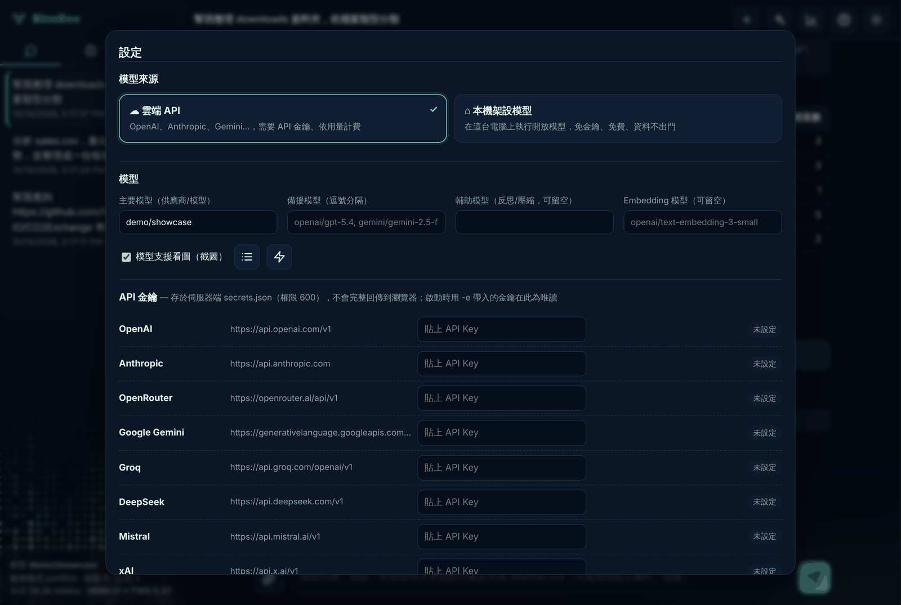

**B. 本機架設模型（免金鑰、免費）**：SinoBee 會分析你電腦的處理器、記憶體、顯示卡，推薦跑得動的模型，按一下就下載並啟用，也能看到每個模型是否正在執行、用 GPU 還是 CPU、佔用多少記憶體。

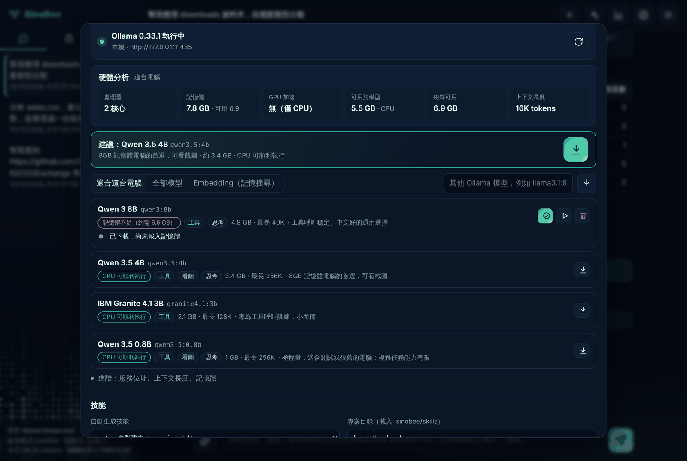

本機模型需要 [Ollama](https://ollama.com)：

- **Mac**：在 Mac 上安裝 Ollama（可用 Apple Silicon 的 GPU 加速），再用下面的指令啟動，SinoBee 會自動找到它並依你的硬體推薦模型：
  ```bash
  SINOBEE_HOST_HARDWARE="$(scripts/host-hardware.sh)" docker compose up -d --build
  ```
- **Windows / Linux**：用內建的 Ollama 容器（有 NVIDIA 顯示卡再加 `-f docker-compose.yml -f docker-compose.gpu.yml`）：
  ```bash
  SINOBEE_HOST_HARDWARE="$(scripts/host-hardware.sh)" docker compose --profile local-llm up -d --build
  ```

### 第 3 步：交代任務

在輸入框用平常說話的方式描述你要的結果，按紙飛機（或 Enter）送出。越具體越好，例如「整理成表格」、「存成 report.md」、「先列出來給我確認再刪」。

## 日常使用技巧

| 想做的事 | 怎麼做 |
|---|---|
| 給它檔案或圖片 | 按迴紋針、直接拖曳進視窗，或貼上截圖 |
| 中途喊停 | 按狀態列或右上角的停止鍵 |
| 複雜任務的品質把關 | 多步驟任務會先列出「驗收清單」（顯示在步驟摘要下方，每項完成都要附證據）；交付前自動檢查產出的檔案（頁面能否開啟、圖片與連結、公式與 Mermaid、JSON／CSV），再依任務風險驗收：**標準**由思維模型（或審查模型）以全新上下文逐項審查實際成果與頁面截圖；**嚴謹**（改程式、研究報告、資料庫數字）再派審查員重新核對來源與檔案。沒通過會帶著修正清單退回，修不好就標示未完成。設定 →「模型」→ 進階可選自動／快速／標準／嚴謹 |
| 同樣的錯不再犯 | 對結果按 👎 並說明哪裡錯，若問題能在檔案裡機械地檢查（例如公式的反斜線被吃掉、報告沒附來源），SinoBee 會建立一條**品質規則**，之後每個任務交付前都會檢查，並存一題回歸測試；也可以直接說「以後報告都要附參考來源」。規則在設定 →「品質」開關或刪除 |
| 復原這一輪改的檔案 | 結果卡上的「復原本輪的檔案變更」會把這一輪改過的檔案放回原樣、移除新建的檔案（shell 指令造成的改動不含在內） |
| 量化品質 | 設定 →「品質」→ 評測，或 `sinobee eval run core -k 3`：在拋棄式工作區重跑固定任務並自動評分，顯示 pass@k（做得到）、pass^k（靠得住）、費用，並列出和上次相比退步的題目。`regressions` 測試組來自你的 👎，`skill:<名稱>` 跑技能自帶的評測 |
| 任務被中斷 | 伺服器重啟或當掉時，SinoBee 每分鐘會檢查被中斷的任務，由輔助模型依工作紀錄整理進度後，在原對話自動續跑（每段對話每天最多 2 次）；打開中斷的對話也會看到「任務中斷」卡片，可以按「立即繼續」 |
| 先想再做 | 指定技能、多階段技能或較長的需求，會先由思維模型規劃（對話裡顯示「思維模型的計畫」與驗收清單），再由執行模型照做；連續出錯、沒有進度或原地打轉時請思維模型給建議。設定 →「模型」→ 進階的「開工前先規劃」可選自動／每次／不規劃 |
| SinoBee 需要你決定時 | 工作中遇到只有你能決定的事（做法、偏好、缺少的資料），會跳出選項卡片，建議做法排第一；點選項或按 1–4，也可以自己輸入想法，或直接在下方輸入框回覆。30 分鐘沒回覆就用建議做法繼續 |
| 指定用某個技能 | 按輸入框旁的技能鍵（拼圖圖示），用中文或英文搜尋、選好再描述任務；或在輸入框打 `/` 直接挑選，例如 `/web-research 比較三家雲端報價`。最多可同時選 5 個 |
| 讓它學一套做法 | 說「記住這個做法」，或輸入 `/learn <網址｜資料夾｜描述>`，或按右上角的學習鍵 |
| 看它在虛擬桌面上的操作 | Docker 模式按右上角的螢幕鍵，可直接接手滑鼠鍵盤 |
| 回顧過去的對話與記憶 | 左側欄的對話、記憶、技能三個分頁 |
| 切換深色／淺色 | 右上角的太陽／月亮 |

回覆支援表格、程式碼、圖片、影片、附件卡片與 mermaid 流程圖；它產生的檔案會以附件呈現，可直接下載。

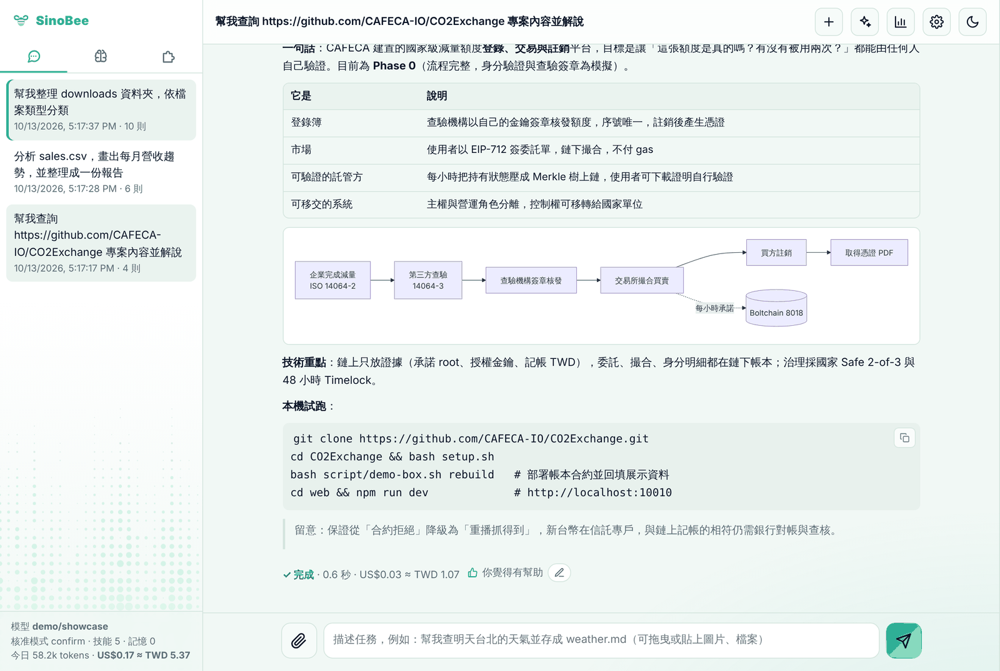

## 管理：用量、技能、權限

### 用量與成本

每次呼叫模型都會記錄 tokens 與花費（依各家費率，含快取折扣；本機模型為 0）。「用量」頁顯示今日、本月、累計花費、每日趨勢、依模型與用途的明細，可設定每日／每月預算（達 80% 提醒，可設定達上限就停止），也能換算成新台幣等幣別。

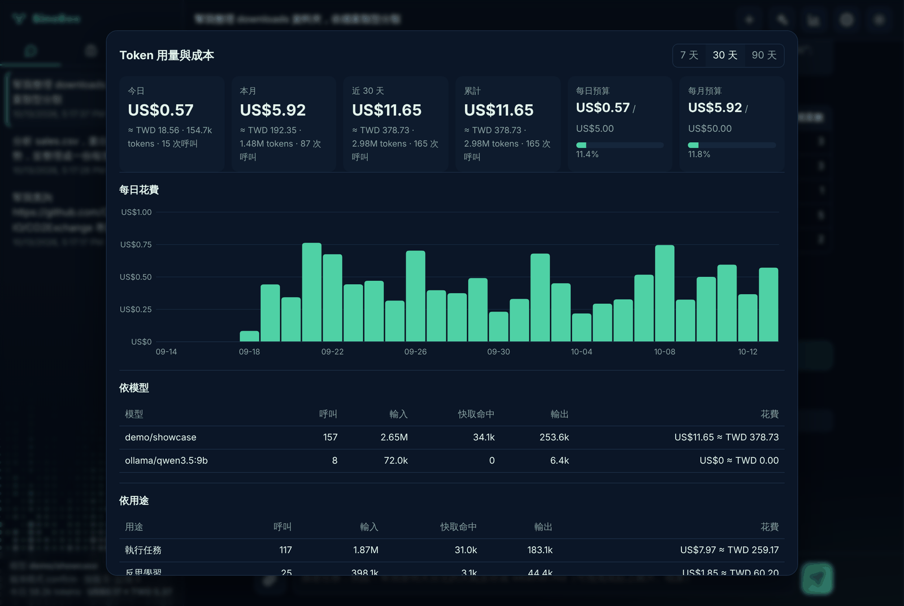

同一頁也有回饋統計：滿意度、依模型與技能的表現、最常見的不滿原因，資料可匯出成 JSONL。

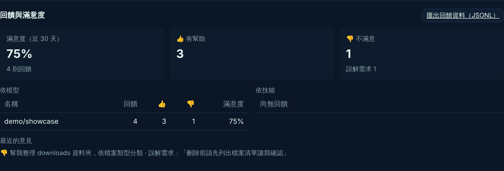

### 技能

技能是 SinoBee 會做的「標準作業流程」。內建技能：

| 類別 | 技能 |
|---|---|
| 辦公文件 | `word-documents`（Word，含追蹤修訂）、`spreadsheets`（Excel，公式重算檢查）、`presentations`（PowerPoint，逐頁截圖檢查）、`pdf-documents`（讀取、合併分割、填表、HTML 轉 PDF） |
| 呈現 | `data-visualization`（色覺安全配色、中文字型）、`frontend-design`（網頁設計，手機與深色模式檢查）、`anatomy`（3D 機構圖）、`dimensional-drawing` / `dimensional-drawing-motion`（Apple 風格元件尺寸圖與動畫，出自 [enesozturk/dimensional-drawing](https://github.com/enesozturk/dimensional-drawing)，MIT） |
| 研究與分析 | `web-research`、`youtube-analysis`、`engineering-feasibility`、`database-analysis` |
| 程式 | `code-review`（找真正的缺陷與資安問題）、`code-repo-explainer` |
| 操作 | `browser-form-filling`、`desktop-automation` |
| 製作 | `ai-video-production` |
| 自身 | `skill-authoring`、`memory-management` |

辦公文件技能需要 `pip install "sinobee[office]"`；畫面截圖與頁面檢查需要 LibreOffice 與 Playwright 的 Chromium（沒有時會說明未檢查）。SinoBee 也會在完成任務後自己生成新技能。每個技能都標示信任級別（內建、官方驗證、本機、專案、自動生成、社群、未信任、已封鎖），來路不明的技能要執行腳本前會先問你。

- 全域技能：`~/.sinobee/skills/`；專案技能：`<專案>/.sinobee/skills/`（信任該專案後才會載入）
- 可以從 GitHub、網址或資料夾安裝，也可以匯出分享；未來可在 [sinobee.ai](https://sinobee.ai) 技能市集取得

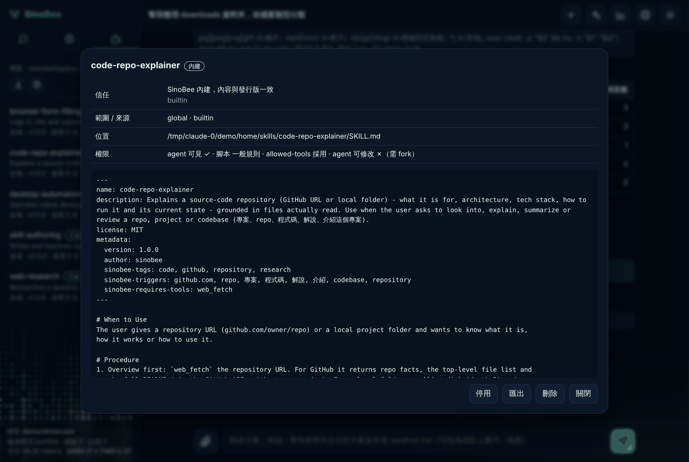

### 權限與安全

- **核准模式**：`confirm`（預設，危險操作要你同意）、`auto`（全自動，建議只在 Docker 內使用）、`readonly`（不准寫入）。
- **能力開關**：可以關掉 shell、檔案、桌面、瀏覽器、網路、記憶、技能任何一項，或限制只能存取指定資料夾。
- **金鑰保護**：只存在 `secrets.json`（權限 600）或啟動參數，介面與 API 不會回傳完整金鑰。
- **內容掃描**：寫進記憶與技能的內容會檢查是否夾帶提示注入或機密。
- 網頁介面預設只開在本機（127.0.0.1）；要給別台電腦連線請設定 `SINOBEE_SERVER_TOKEN`。

## 進階設定與指令

<details>
<summary><b>啟動時直接帶入模型與金鑰</b></summary>

```bash
# 互動輸入金鑰（不會留在指令歷史）
scripts/docker-run.sh -m anthropic/claude-sonnet-4-5 -k anthropic

# 多組金鑰 + 每月預算 30 美元
scripts/docker-run.sh -m openai/gpt-5.4 -k openai=sk-... -k gemini=AIza... -b 30

# 同時啟動本機模型服務
scripts/docker-run.sh --local-llm

# 容器執行中新增金鑰
docker exec -it sinobee sinobee keys set openai
```

設定優先序：內建預設 < `config.yaml` < 網頁設定 < 啟動參數。啟動參數帶入的值在網頁上會顯示 🔒 唯讀。

| 啟動參數 | 用途 |
|---|---|
| `SINOBEE_MODEL` / `SINOBEE_THINKING_MODEL` / `SINOBEE_REVIEWER_MODEL` / `SINOBEE_FALLBACKS` / `SINOBEE_AUX_MODEL` / `SINOBEE_EMBEDDING_MODEL` | 執行／思維／審查／備援／輔助／Embedding 模型（格式 `供應商/模型`；舊的 `SINOBEE_ESCALATE_MODEL` 視為思維模型） |
| `OPENAI_API_KEY`、`ANTHROPIC_API_KEY`、`GEMINI_API_KEY`、`OPENROUTER_API_KEY`、`DEEPSEEK_API_KEY`、`DASHSCOPE_API_KEY`… | 各家金鑰 |
| `SINOBEE_APPROVAL` / `SINOBEE_TOOLSETS` | 核准模式 / 開放的能力 |
| `SINOBEE_DAILY_BUDGET` / `SINOBEE_MONTHLY_BUDGET` | 預算（USD） |
| `SINOBEE_OLLAMA_URL` / `SINOBEE_HOST_HARDWARE` | 本機模型服務位址 / 主機硬體資訊 |
| `SINOBEE_PROJECT` | 專案資料夾（載入其中的技能） |
| `SINOBEE_SERVER_TOKEN` / `VNC_PASSWORD` | 網頁存取權杖 / 虛擬桌面密碼（桌面只經由 SinoBee 的頁面觀看，不再開放 6080） |

資料保存在 Docker volume `sinobee-home`（設定、金鑰、記憶、技能、瀏覽器登入）與 `sinobee-workspace`（工作檔案）；更新版本用 `git pull && docker compose up -d --build`，資料不會遺失。
</details>

<details>
<summary><b>不用 Docker，直接操作你的電腦</b></summary>

需要 Python 3.10 以上。

```bash
bash scripts/install-command.sh  # 只需一次：建立 .venv、安裝（含瀏覽器元件），並讓 sinobee 在任何終端機都能用
sinobee serve                    # 之後在任何資料夾執行即可，開啟 http://127.0.0.1:10024
```

`sinobee serve` 預設只接受本機連線（127.0.0.1）；要讓區網其他裝置連入，改用 `sinobee serve --host 0.0.0.0` 並設定 `SINOBEE_SERVER_TOKEN`。macOS/Windows 操作桌面請自行 `.venv/bin/pip install -e ".[all,desktop-native]"`。

macOS 需在「系統設定 → 隱私權與安全性」授予終端機「輔助使用」與「螢幕錄製」權限。在實體電腦上建議保持核准模式 `confirm`。
</details>

<details>
<summary><b>開放其他裝置連線（手機、平板、其他電腦）</b></summary>

預設只有這台電腦能開（127.0.0.1）。要讓同一個網路的其他裝置使用：

```bash
sinobee serve --public                 # 監聽所有網路介面，第一次會產生存取權杖並存在 secrets.json
sinobee serve --public --new-token     # 換一組新的權杖（舊網址立即失效）
sinobee serve --public --token <自訂>   # 這次改用指定的權杖
SINOBEE_SERVER_TOKEN=<權杖> sinobee serve --host 0.0.0.0   # 用環境變數指定
```

啟動時會印出 `http://<這台電腦的 IP>:10024/?token=…`，在其他裝置開啟即可。

- 權杖一律存在（包括只在這台電腦使用時）：在這台電腦開 `http://localhost:10024` 會自動登入；其他裝置用含 `?token=` 的網址開一次，之後這個瀏覽器會記住（HttpOnly Cookie，網頁程式讀不到），網址列裡的權杖也會移除。
- 沒有權杖或權杖錯誤時，畫面會請你輸入。
- 其他網站的網頁無法操作 SinoBee：會檢查請求來源（Origin）與主機名稱（Host），擋下 DNS rebinding。用自己的網域或通道名稱連線時，把它加到設定檔的 `server.allowed_hosts`（例如 `["*.ts.net"]`）。

Docker：

```bash
SINOBEE_BIND=0.0.0.0 SINOBEE_SERVER_TOKEN="$(openssl rand -hex 24)" docker compose up -d --build
scripts/docker-run.sh --public         # 自動產生權杖並印出其他裝置可用的網址
```

安全提醒：

- 能連上的人就能操作這台電腦，請只在信任的網路開放，並保持核准模式為 `confirm`。
- 跨網際網路使用時，不要直接開放連接埠，改用 HTTPS 通道，例如 `tailscale serve 10024` 或 `cloudflared tunnel --url http://localhost:10024`。
- 防火牆需允許 TCP 10024：macOS 第一次會詢問是否允許 Python 接受連線；Linux 用 `sudo ufw allow 10024/tcp`。
</details>

<details>
<summary><b>命令列</b></summary>

```bash
sinobee serve [--public]                           # Web UI（--public：開放其他裝置，需權杖）
sinobee chat -m anthropic/claude-sonnet-4-5        # 終端機對話
sinobee run "幫我整理 ~/Downloads 裡的 PDF 並列出清單"
sinobee doctor                                      # 檢查模型、瀏覽器、桌面控制
sinobee keys list|set <provider>|rm <provider>
sinobee memory list|search <q>|forget <id>|pin|unpin|restore|stats|maintain|compress [--apply]
sinobee skills list|install|export|trust|validate …
sinobee usage month --by model
sinobee work                                        # 背景工作：過去／現在／接下來
```
</details>

<details>
<summary><b>疑難排解</b></summary>

| 狀況 | 處理方式 |
|---|---|
| 結果顯示「錯誤」 | 結果卡會寫原因與建議，展開「技術細節」看原始訊息；常見是金鑰無效、模型名稱錯誤或額度用完 |
| 本機模型「服務未執行」 | 安裝並開啟 Ollama，或用 `docker compose --profile local-llm up -d`，再按「重新偵測」 |
| 本機模型很慢 | 改選標示「GPU 加速順暢」的較小模型；Mac 請在 Mac 本機安裝 Ollama，不要用容器 |
| 本機模型無法操作電腦 | 改選標示「工具」的模型 |
| 更新後畫面沒變 | `docker compose up -d --build`，瀏覽器強制重新整理 |
</details>

## 文件與開發

- 架構設計：[docs/ARCHITECTURE.md](docs/ARCHITECTURE.md)（記憶、技能、模型層、本機模型、成本計算、回饋學習）
- 技能規格、信任機制與 Hub 協定：[docs/SKILL_HUB.md](docs/SKILL_HUB.md)

```bash
pip install -e ".[all,dev]"
pytest
```

## 授權

[MIT](LICENSE) © 2026 CAFECA
