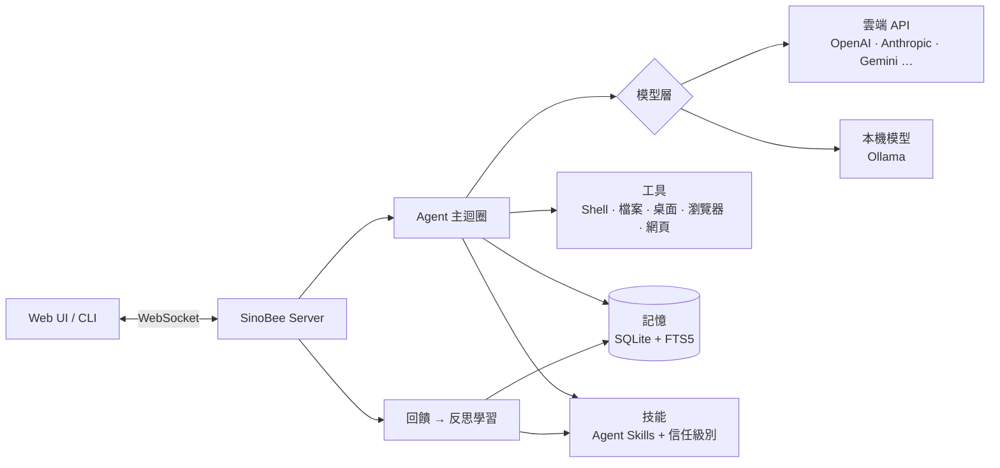

# SinoBee 🐝

**Open Source Swarm Intelligence Agents** — 開源、模型中立的自主 AI Agent。

授權後即可操作電腦（終端機、檔案、滑鼠鍵盤、瀏覽器）完成各式任務，並透過分層記憶、自我演化技能與使用者回饋越用越強。SinoBee 本身不內建模型：可串接任何主流雲端模型 API，也可以在你的電腦上直接架設開放模型（免金鑰、免費）。架構參考 [Hermes Agent](https://hermes-agent.nousresearch.com/)，並重新設計記憶與技能系統。

- [功能總覽](#功能總覽)
- [快速開始（Docker）](#快速開始docker)
- [模型：雲端 API 或本機架設](#模型雲端-api-或本機架設)
- [技能（Agent Skills）](#技能agent-skills)
- [對話介面](#對話介面)
- [回饋與自我學習](#回饋與自我學習)
- [Token 用量與成本](#token-用量與成本)
- [本機安裝](#本機安裝直接控制你的電腦)
- [安全與權限](#安全與權限)
- [常用指令](#常用指令) · [疑難排解](#疑難排解) · [開發](#開發)

## 功能總覽

| | |
|---|---|
| **任意模型** | OpenAI、Anthropic、Gemini、OpenRouter、DeepSeek、Groq、xAI、Mistral、Qwen、Zhipu、Moonshot、Together、Fireworks、vLLM、LM Studio 與任何 OpenAI 相容端點；備援鏈自動切換 |
| **本機架設模型** | 分析 CPU／記憶體／GPU（NVIDIA、AMD、Apple Silicon）推薦可執行的模型；介面一鍵下載、啟動、停止，即時顯示執行狀態（Ollama）；免 API 金鑰 |
| **電腦操作** | Shell、檔案、桌面滑鼠鍵盤與截圖（xdotool / pyautogui）、真實 Chromium 瀏覽器（Playwright，元素 ref 快照）、網頁搜尋與閱讀（GitHub 專案走 API 快速路徑） |
| **四層記憶** | 核心 / 工作 / 長期語意（BM25 + 向量混合檢索，中文分詞）/ 情節；以 ID 編輯、版本鏈、自動整併 |
| **自我演化技能** | 嚴格符合 [Agent Skills 標準](https://agentskills.io)；專案 `.sinobee/skills/` 與全域 `~/.sinobee/skills/`；8 級信任標籤；主動／被動自動生成；可接 sinobee.ai Skill Hub |
| **回饋學習** | 每輪任務可 👍／👎 並註明原因，背景反思寫入記憶、調整技能；滿意度統計與 JSONL 資料匯出 |
| **成本透明** | 記錄每次呼叫的 tokens 與花費（含快取計價），每日／每月預算、用量儀表板 |
| **豐富的對話介面** | Markdown 表格、圖片、影片、附件、mermaid 圖表；拖曳上傳；即時任務狀態與停止；深色／淺色主題 |
| **Docker 一鍵執行** | 內建虛擬桌面 + noVNC，Web UI 即時觀看與接手；金鑰只在 GUI 設定或啟動指令帶入，不寫入 `.env` |
| **授權可控** | Toolset 白名單、`auto / confirm / readonly` 核准模式、危險指令偵測、寫入內容安全掃描 |



架構設計見 [docs/ARCHITECTURE.md](docs/ARCHITECTURE.md)，技能規格、信任機制與 Hub 協定見 [docs/SKILL_HUB.md](docs/SKILL_HUB.md)。

## 快速開始（Docker）

需求：Docker（Docker Desktop 或 Docker Engine + Compose v2）。金鑰不寫進任何檔案，以下方式可以混用。

**A. 啟動後在 Web UI 設定（建議）**

```bash
git clone https://github.com/CAFECA-IO/SinoBee.git && cd SinoBee
docker compose up -d --build
```

開啟 http://localhost:8000 ，首次啟動會自動跳出「設定」，模型來源二選一：

- **雲端 API**：選擇主要模型、貼上該供應商的 API Key、按「測試連線」後儲存，立即生效不需重啟。金鑰存在容器內 `~/.sinobee/secrets.json`（volume `sinobee-home`，權限 600），API 只回傳遮罩後的末四碼。
- **本機架設模型**：不需要金鑰，見下方[本機架設模型](#本機架設模型免-api-金鑰)。

**B. 啟動時用指令帶入**

```bash
# 互動輸入金鑰（不留在 shell 歷史與 ps 中）
scripts/docker-run.sh -m anthropic/claude-sonnet-4-5 -k anthropic

# 一次帶多組，並設定每月預算 30 美元
scripts/docker-run.sh -m openai/gpt-5.4 -k openai=sk-... -k gemini=AIza... -b 30

# 同時啟動本機模型服務（免金鑰）
scripts/docker-run.sh --local-llm

# 或直接用 compose（只傳入有設定的變數）
SINOBEE_MODEL=openai/gpt-5.4 OPENAI_API_KEY=sk-... docker compose up -d --build

# 容器已在執行時新增金鑰（隱藏輸入，存入 secrets.json）
docker exec -it sinobee sinobee keys set openai
```

設定優先序：內建預設 < `config.yaml` < Web UI 設定 < 啟動指令（`-e`）。用 `-e` 帶入的模型、金鑰、預算等，在 GUI 中會顯示 🔒 並唯讀，避免兩處設定互相覆蓋；要改請重新啟動容器。注意 `-e KEY=值` 會出現在 `docker inspect`，介意的話請改用 GUI 或 `sinobee keys set`。

| 啟動參數 | 用途 |
|---|---|
| `SINOBEE_MODEL` / `SINOBEE_FALLBACKS` / `SINOBEE_AUX_MODEL` / `SINOBEE_EMBEDDING_MODEL` | 主要／備援／輔助（反思、壓縮）／Embedding 模型 |
| `<PROVIDER>_API_KEY`（如 `OPENAI_API_KEY`、`ANTHROPIC_API_KEY`、`GEMINI_API_KEY`、`OPENROUTER_API_KEY`、`DEEPSEEK_API_KEY`、`DASHSCOPE_API_KEY`…） | 金鑰 |
| `SINOBEE_APPROVAL` / `SINOBEE_TOOLSETS` | 權限 |
| `SINOBEE_DAILY_BUDGET` / `SINOBEE_MONTHLY_BUDGET` | 預算（USD） |
| `SINOBEE_OLLAMA_URL` / `SINOBEE_HOST_HARDWARE` | 本機模型服務位址（預設自動偵測）/ 主機硬體資訊（`scripts/host-hardware.sh`） |
| `SINOBEE_PROJECT` | 專案目錄（載入其 `.sinobee/skills`） |
| `SINOBEE_SERVER_TOKEN` / `VNC_PASSWORD` | Web UI 存取權杖 / noVNC 密碼 |

- Web UI：http://localhost:8000 （對話、記憶、技能、用量、設定；「即時桌面」可看 agent 操作並接手）
- 虛擬桌面（noVNC）：http://localhost:6080/vnc.html
- 資料保存在 volume `sinobee-home`（容器內 `~/.sinobee`：設定、金鑰、記憶資料庫、全域技能、瀏覽器登入）與 `sinobee-workspace`（`~/workspace`：專案與上傳檔案）
- 更新版本：`git pull && docker compose up -d --build`（資料在 volume 中，不會遺失）

## 模型：雲端 API 或本機架設

### 雲端 API

格式為 `供應商/模型`，在設定頁可「載入可用模型清單」挑選並「測試連線」：

| 範例 | 金鑰環境變數 |
|---|---|
| `openai/gpt-5.4` | `OPENAI_API_KEY` |
| `anthropic/claude-sonnet-4-5` | `ANTHROPIC_API_KEY` |
| `gemini/gemini-3.1-pro` | `GEMINI_API_KEY` |
| `openrouter/anthropic/claude-sonnet-4.5` | `OPENROUTER_API_KEY` |
| `deepseek/deepseek-v4-flash` | `DEEPSEEK_API_KEY` |
| `qwen/qwen-max` | `DASHSCOPE_API_KEY` |
| `自訂名稱/模型` | 設定頁「自訂 OpenAI 相容端點」或 `config.yaml` 的 `providers.<名稱>.base_url` |

- **備援模型**：主要模型失敗（429、5xx、網路）時依序改用；**輔助模型**：反思與上下文壓縮可指定較便宜的模型。
- 電腦操作任務建議使用支援工具呼叫與視覺（看截圖）的模型。Gemini 3 的 thought signature、推理模型的輸出預算等相容性細節已自動處理。

### 本機架設模型（免 API 金鑰）

設定 → 模型來源選「**本機架設模型**」：

1. **硬體分析**：偵測處理器、記憶體、GPU（NVIDIA／AMD／Apple Silicon 統一記憶體）與磁碟空間，算出可用於模型的記憶體與合適的上下文長度。
2. **模型推薦**：內建精選清單只收支援工具呼叫、能操作電腦的模型（例如 Qwen 3.5／3.8、Gemma 4、gpt-oss、Mistral Small、Granite），每個標示「GPU 加速順暢／CPU 可執行／偏慢／記憶體不足」並給出推薦；也可輸入任何 Ollama 模型名稱下載。
3. **一鍵下載並使用**：顯示下載進度，完成後自動設為主要模型並載入記憶體。每個模型顯示 未下載／下載中／已下載／載入中／**執行中**（GPU 或 CPU、佔用記憶體、上下文長度、何時釋放），可啟動、停止、刪除；左下角隨時顯示目前本機模型的狀態。
4. **Embedding 模型**（如 `nomic-embed-text`）讓長期記憶支援語意搜尋。

選用本機模型時不需要也不會要求 API 金鑰，費用計為 0。SinoBee 透過 Ollama 原生 API 要求足夠的上下文（`num_ctx`），並依此提前壓縮對話，避免本地模型靜默截斷。

需要 [Ollama](https://ollama.com)（開源的本地模型執行器），三種方式擇一：

```bash
# A. Mac 建議：在主機安裝 Ollama（可用 Metal GPU），SinoBee 自動連到 host.docker.internal
SINOBEE_HOST_HARDWARE="$(scripts/host-hardware.sh)" docker compose up -d --build

# B. 使用內建的 Ollama 容器（Linux + NVIDIA GPU 再加 -f docker-compose.yml -f docker-compose.gpu.yml）
SINOBEE_HOST_HARDWARE="$(scripts/host-hardware.sh)" docker compose --profile local-llm up -d --build

# C. docker-run 腳本：偵測到主機的 Ollama 就使用，否則啟動 Ollama 容器（有 GPU 就用）
scripts/docker-run.sh --local-llm
```

- `SINOBEE_HOST_HARDWARE` 讓容器內的 SinoBee 知道主機的真實硬體（容器看不到 Mac 的 GPU 與統一記憶體），推薦才準確。
- 本機直接安裝（非 Docker）且電腦已裝 Ollama 時，設定頁可按「啟動本地服務」由 SinoBee 代為啟動。
- Ollama 在其他機器上時，於「進階」填入服務位址與可用記憶體。

## 技能（Agent Skills）

| 位置 | 用途 |
|---|---|
| `<專案>/.sinobee/skills/<name>/SKILL.md` | 專案技能，隨 repo 共享；需先「信任此專案」才會載入 |
| `~/.sinobee/skills/<name>/SKILL.md` | 全域 / 共享技能（內建技能也在此） |
| `.agents/skills/`（專案與家目錄） | 與其他支援 Agent Skills 的 agent 互通 |

- 對話中輸入 `/技能名稱 …` 直接啟用；`/learn <網址｜資料夾｜描述>` 讓 SinoBee 學一個新技能；或說「記住這個做法」。
- **自適應生成**：完成多步驟、重複出現或出錯後修好的任務後自動建立技能（標示 experimental，成功使用兩次後轉正）；使用者負評也會觸發修補。設定頁可改為「建議，由我核准」或關閉。
- **信任級別**：內建／官方驗證／本機／專案／自動生成／社群／未信任／已封鎖，各自決定是否可見、腳本是否需核准、agent 可否修改。技能頁顯示來源、權限與內容雜湊，可核准、停用、匯出、回復版本、刪除。
- 內建技能：網頁研究、桌面自動化、瀏覽器表單填寫、程式專案解說、技能撰寫。

```bash
sinobee skills list | validate <name|path> | doctor
sinobee skills trust                     # 信任目前專案的技能
sinobee skills install hub:cafeca/einvoice-download-tw | github:owner/repo/path | https://…/SKILL.md | ./dir
sinobee skills export <name> -o dist/    # 打包分享；publish 發布到 sinobee.ai（Hub 上線後）
```

## 對話介面

介面採深藍到薄荷綠的網點（halftone）視覺，右上角 ☀︎／☾ 切換深色與淺色；操作按鈕皆為 SVG 圖示（如紙飛機＝送出、迴紋針＝附加檔案），滑鼠移上去會顯示說明。

- **Markdown**：GFM 表格、程式碼（一鍵複製）、引言、任務清單，以及 ```` ```mermaid ```` 圖表（流程圖、時序圖、甘特圖⋯⋯，語法錯誤時顯示原始碼與錯誤訊息）。
- **媒體與附件**：圖片 ``、影片（`.mp4/.webm/.mov` 以播放器呈現）、音訊、附件（`[報告.pdf](路徑)` 顯示為含大小與下載的檔案卡）。Agent 產生在工作區的檔案可直接嵌入；檔案經 `/api/files` 提供，僅限工作區、專案資料夾與 `allowed_paths`，設定與金鑰檔一律拒絕。
- **上傳**：📎 按鈕、拖曳或貼上即可附加檔案（存到 `workspace/uploads/日期/`），圖片會一併送給支援視覺的模型。
- **任務狀態**：狀態列顯示執行中／目前步驟／正在使用的工具／經過時間，可隨時「停止」；結束後顯示 完成／錯誤／未完成／已停止 與可讀的原因與建議；重新整理頁面或從其他分頁開啟都會保留。
- **即時桌面**：Docker 模式可在側邊開啟 agent 的虛擬桌面，直接接手操作。

## 回饋與自我學習

每輪任務結束後可按 👍 / 👎，👎 可勾選原因（答案不正確、沒有完成、誤解需求、格式不好、太慢、太貴、做了不該做的事）並留言。回饋會：

1. 存入資料庫，並與該輪的模型、使用的技能、步數、花費關聯；
2. 在背景觸發「回饋反思」：以使用者評價為準，寫入長期記憶（偏好／教訓）、調整技能評分，必要時修補或建立技能（受信任級別與 `auto_create` 設定約束）；
3. 在「用量」頁的「回饋與滿意度」顯示滿意度、依模型／技能的統計、常見負評原因與最近意見，並可匯出 JSONL（含任務、回覆、評價）供評估或微調。

## Token 用量與成本

每次模型呼叫（執行任務、反思學習、上下文壓縮、連線測試、向量嵌入）都會記錄輸入／快取命中／快取寫入／輸出 tokens，並依各家費率換算美元：

- 「用量」頁：今日／本月／區間／累計花費、每日花費圖、依模型／用途／對話的明細、預算進度、內建費率表
- 每輪任務結束顯示本輪 tokens 與花費
- 每日／每月預算（達 80% 提醒，可選擇達上限即停止呼叫模型）、顯示幣別與匯率（例如 TWD 32.5）
- 內建費率為 2026-10-13 依各家公開價目整理的參考價；可在設定頁「費率覆寫」修正或補上自訂模型，未設定費率的模型會提示；本機模型計為 0
- Agent 自己也能查：問「你這個月花了多少？」會呼叫 `usage_stats` 工具；CLI：`sinobee usage month --by model`

## 本機安裝（直接控制你的電腦）

需求：Python 3.10 以上。

```bash
pip install -e ".[all]"          # macOS/Windows 桌面控制請改用 ".[all,desktop-native]"
python -m playwright install chromium
sinobee serve                    # Web UI → http://localhost:8000，在「設定」選模型（雲端或本機）
# 或純終端機：
sinobee keys set anthropic       # 隱藏輸入，存入 ~/.sinobee/secrets.json
sinobee doctor                   # 檢查模型金鑰、瀏覽器、桌面控制
sinobee chat -m anthropic/claude-sonnet-4-5
sinobee run "幫我整理 ~/Downloads 裡的 PDF 並列出清單"
```

> macOS 需在「系統設定 → 隱私權與安全性」授予終端機 **輔助使用** 與 **螢幕錄製** 權限，才能操作滑鼠鍵盤與截圖。
> 在實體電腦上建議保持 `approval: confirm`。

## 安全與權限

- **金鑰**：只存在 `secrets.json`（權限 600）或啟動環境變數；API 與介面只顯示遮罩值；不使用 `.env`。
- **核准模式**：`confirm`（預設，危險操作需你在介面核准）、`auto`（全自動，建議只在 Docker 沙箱使用）、`readonly`（禁止寫入）。
- **能力白名單**：可關閉 shell、files、desktop、browser、web、memory、skills、usage 任一類工具；`allowed_paths` 限制可存取的資料夾。
- **技能安全**：外部或自動生成的技能預設不可信，腳本執行需核准；寫入記憶與技能的內容會掃描提示注入與機密外洩；被撤銷的技能自動封鎖。
- **Web UI**：預設只綁定 `127.0.0.1`；對外開放時請設定 `SINOBEE_SERVER_TOKEN`。

## 常用指令

```bash
sinobee serve [--port 8000]
sinobee chat | run "<任務>"
sinobee memory list|search <q>|forget <id>|consolidate
sinobee skills list|show|validate|doctor|approve|trust|fork|install|export|publish|outdated|update …
sinobee keys list|set <provider>|rm <provider>
sinobee usage today|7d|30d|month|all [--by model|purpose|day|session]
sinobee doctor
```

## 疑難排解

| 狀況 | 處理方式 |
|---|---|
| 不知道 agent 是否還在工作 | 看輸入框上方的狀態列（步驟、工具、經過時間）；可按「停止」 |
| 任務結果顯示「錯誤」 | 結果卡會說明原因與建議，展開「技術細節」可看原始錯誤；常見為金鑰無效、模型名稱錯誤或額度用完 |
| 本機模型「服務未執行」 | 安裝並開啟 Ollama，或用 `docker compose --profile local-llm up -d`；設定頁按「重新偵測」 |
| 本機模型回應很慢 | 改選標示「GPU 加速順暢」的較小模型；Mac 請在主機安裝 Ollama 而非容器 |
| 本機模型無法操作電腦 | 改選標示「工具」的模型 |
| 更新後介面沒變 | `docker compose up -d --build` 重建映像，瀏覽器強制重新整理 |

## 開發

```bash
pip install -e ".[all,dev]"
pytest
```

```
sinobee/
  agent/      主迴圈、提示詞、上下文壓縮、錯誤說明
  providers/  OpenAI 相容、Anthropic、Ollama 原生傳輸與備援鏈
  local/      本機模型：硬體分析、模型目錄、Ollama 管理
  memory/     SQLite 記憶、對話、用量、回饋
  skills/     Agent Skills 解析驗證、信任級別、Hub 用戶端
  learning/   任務反思與回饋學習
  tools/      shell、files、desktop、browser、web、memory、skills、usage
  server/     FastAPI + WebSocket、Web UI（static/）
docker/  scripts/  docs/  tests/
```

## 授權

[MIT](LICENSE) © 2026 CAFECA
