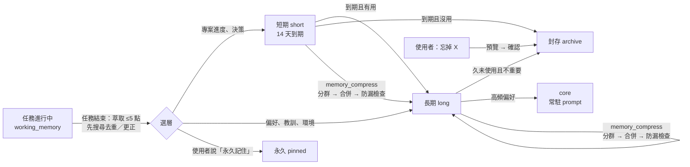

# SinoBee 架構設計

> 版本：0.1（MVP）・ 參考對象：[Hermes Agent](https://hermes-agent.nousresearch.com/docs/developer-guide/architecture)（Nous Research）

SinoBee 是一個「不內建模型」的通用 AI Agent。它把任何主流 LLM 當作大腦，透過**經授權的電腦操作能力**（Shell、檔案、滑鼠鍵盤、瀏覽器）完成任務，並以**分層記憶**與**自我演化技能**讓自己越用越好。

---

## 1. 設計目標

| 目標 | 做法 |
|---|---|
| 模型中立 | 內部統一訊息格式，透過 Provider 轉接任何 API（OpenAI 相容、Anthropic、Gemini、本地 Ollama/vLLM…），支援備援鏈 |
| 能做任何事 | 以「工具」操作電腦：Shell、檔案、桌面（滑鼠/鍵盤/截圖）、瀏覽器（Playwright）、網頁搜尋 |
| 可在 Docker 執行 | 映像內建 Xvfb 虛擬桌面 + noVNC，agent 在容器中有完整桌面，使用者可即時觀看 |
| 授權可控 | Toolset 白名單 + 三段式核准模式（auto / confirm / readonly）+ 危險指令偵測 |
| 越用越強 | 分層記憶（核心 / 工作 / 長期語意 / 情節）＋ 技能自動建立、修補、評分、版本化 |
| Prompt 快取友善 | System prompt 只放穩定內容；動態內容（回憶、工作記憶、相關技能）放在訊息尾端 |

## 2. 系統總覽

```
          ┌─────────────── 入口 (Entry points) ───────────────┐
          │  CLI (sinobee chat)   Web UI / REST / WebSocket     │
          └───────────────────────┬────────────────────────────┘
                                  ▼
                      ┌───────────────────────┐
                      │   Agent（agent/loop）  │  ← 單一核心，所有入口共用
                      │ prompt 組裝 · 工具迴圈 │
                      │ 上下文壓縮 · 事件回呼  │
                      └──┬─────────┬──────┬───┘
            ┌────────────┘         │      └─────────────┐
            ▼                      ▼                    ▼
   ┌─────────────────┐   ┌──────────────────┐   ┌────────────────────┐
   │ Providers        │   │ Tool Registry     │   │ Learning           │
   │ OpenAI 相容      │   │ shell · files     │   │ Memory（4 層）     │
   │ Anthropic        │   │ desktop · browser │   │ Skills（SKILL.md） │
   │ Gemini           │   │ web · memory      │   │ Reflector（反思）  │
   │ 備援鏈 / 重試    │   │ skills · approval │   └─────────┬──────────┘
   └─────────────────┘   └──────────────────┘             ▼
                                               SQLite（FTS5 + 向量）
                                               ~/.sinobee
```

### 目錄結構

```
sinobee/
├── config.py            設定載入（YAML + 環境變數）
├── types.py             內部統一訊息格式
├── providers/           模型轉接層
│   ├── base.py          Provider 介面、重試、備援鏈
│   ├── openai_compat.py OpenAI / OpenRouter / Groq / DeepSeek / xAI / Mistral / Ollama / vLLM / Gemini(相容端點)…
│   ├── anthropic.py     Anthropic Messages API（含 prompt caching）
│   └── __init__.py      預設供應商表與解析器
├── agent/
│   ├── loop.py          Agent 主迴圈
│   ├── prompt.py        System prompt 分層組裝
│   └── context.py       Token 估算與上下文壓縮
├── tools/
│   ├── registry.py      工具註冊、schema、分派、核准
│   ├── approval.py      危險指令偵測與核准政策
│   ├── shell.py files.py web.py
│   ├── desktop.py       滑鼠鍵盤截圖（xdotool / pyautogui 後端）
│   ├── browser.py       Playwright 瀏覽器（元素 ref 快照）
│   ├── memory_tools.py  skill_tools.py
├── memory/store.py      分層記憶 + 對話 / 情節儲存
├── skills/
│   ├── spec.py          Agent Skills 規格：寬鬆解析、嚴格驗證、正規化
│   ├── trust.py         信任級別、政策矩陣、內容雜湊、出處鎖檔、專案信任
│   ├── manager.py       多範圍探索、目錄、啟用、撰寫（版本化）、成效與生命週期
│   └── hub.py           安裝（hub / GitHub / URL / 本機）、匯出、發布、更新、撤銷
├── learning/reflector.py 任務後反思：萃取記憶、建立 / 修補技能
├── pricing.py           各家費率表與成本計算
├── accounting.py        用量歸屬（session / 用途）
├── secrets.py           金鑰儲存（secrets.json, 0600）
├── server/              FastAPI + WebSocket + 靜態 Web UI（含設定頁、用量頁）
└── cli.py
docker/                  supervisord、entrypoint（Dockerfile 在根目錄）
scripts/docker-run.sh    以指令帶入模型與金鑰啟動容器
sinobee/bundled_skills/  內建技能（首次啟動安裝到 ~/.sinobee/skills，信任級別 builtin）
```

## 3. Agent 主迴圈

```
run(user_input):
  1. recall   = memory.recall(user_input)           # 長期記憶 + 情節檢索（top-k）
  2. skills   = skills.relevant(user_input)          # 相關技能索引（top-n）
  3. messages = [system(穩定)] + history + user(輸入 + <context>recall/skills/工作記憶</context>)
  4. loop (≤ max_iterations):
       resp = provider.chat(messages, tools)
       若無 tool_calls → 結束
       for call in tool_calls:
           approval.check(call) → 執行 → 結果（文字或圖片）加入 messages
       若估計 token > 門檻 → context.compress()（摘要中段對話）
  5. 儲存對話；背景觸發 reflector（依「學習訊號」決定是否反思）
```

- **事件回呼**：每個步驟（模型輸出、工具呼叫、工具結果、核准請求）都會送出事件，CLI 顯示於終端、Web UI 經 WebSocket 即時呈現。
- **可中斷**：`agent.cancel()` 在下一個安全點停止。
- **多模態**：工具可回傳圖片（截圖），若模型支援視覺就直接附上；否則改附文字說明（例如瀏覽器的元素清單）。

## 4. 模型中立層（Providers）

- 內部訊息格式：`Message(role, content: str | [TextPart | ImagePart], tool_calls, tool_call_id)`，各 Provider 負責雙向轉換。
- **兩種傳輸**即可覆蓋主流：
  - `openai`（Chat Completions 相容）：OpenAI、Azure、OpenRouter、Groq、DeepSeek、Mistral、xAI、Together、Fireworks、Ollama、vLLM、LM Studio，以及 Gemini 的 OpenAI 相容端點。
  - `anthropic`（Messages API）：原生 tool use、圖片、prompt caching 斷點。
  - `ollama`（Ollama 原生 `/api/chat`、`/api/embed`）：本機架設模型；可逐次指定 `num_ctx`（OpenAI 相容端點會忽略而截斷在 4k），並回報 token 數。
- 設定以 `provider/model` 指定，例如 `anthropic/claude-sonnet-4-5`、`openai/gpt-4.1`、`ollama/qwen3.5:9b`；`base_url`、`api_key_env` 可覆寫。
- **備援鏈**：`model.fallbacks` 依序嘗試；429 / 5xx 自動指數退避重試。
- **輔助模型**：反思、壓縮可指定較便宜的 `auxiliary_model`，降低成本（Hermes 的背景審查成本問題）。

## 5. 記憶系統（相對 Hermes 的優化）

### Hermes 的作法與限制
Hermes 以 `MEMORY.md`（2,200 字元）與 `USER.md`（1,375 字元）注入 system prompt，加上 SQLite FTS5 的對話搜尋。官方文件自己列出的弱點：容量僅約 1,300 tokens、會話中寫入要到下個會話才看得到（凍結快照）、沒有讀取動作、`replace` 以子字串比對容易歧義、背景審查成本高、無語意檢索。

### SinoBee：四層記憶

| 層 | 內容 | 儲存 | 注入方式 |
|---|---|---|---|
| **L0 核心記憶** | 使用者輪廓、agent 身分與長期規則（少量、高重要度） | SQLite `memories`（tier=core）| 會話開始時放入 system prompt（穩定、可快取） |
| **L1 工作記憶** | 當前任務目標、計畫、已知事實、待辦 | 會話內 scratchpad | 每輪附在最新 user 訊息尾端 → **會話內即時可見**，又不破壞 prefix cache |
| **L2 長期語意記憶** | 事實、偏好、教訓、環境知識；含重要度、信心、存取次數、時間 | SQLite + FTS5（BM25）＋ 可選向量 | 每輪依輸入**自動召回 top-k**，並提供 `memory_search` 主動查詢 |
| **L3 情節記憶** | 完整對話紀錄 + 每個會話結束時的 LLM 摘要 | SQLite + FTS5 | `session_search` 查詢；摘要參與自動召回 |

**關鍵改進**

1. **以 ID 編輯**：每筆記憶有短 ID（如 `m3f9a`），`memory_update/forget` 直接指定 ID，消除子字串歧義；更新採「取代鏈」（`superseded_by`），保留歷史可追溯、可回復。
2. **混合檢索**：分數 = `α·BM25 + β·cosine(embedding) + γ·重要度 + δ·新近度(半衰期) + ε·log(存取次數)`；沒設定 embedding 模型時自動退化為 BM25 + 中繼資料排序，零依賴也能運作。中文以字元 bigram 斷詞建立 FTS 索引，確保中文檢索有效。
3. **容量不受 prompt 大小限制**：核心層只放最重要的少數條目（預設 ≤ 1,500 字元），其餘存於長期層按需召回；容量可到數萬筆。
4. **自動整併（consolidation）**：反思時偵測近似重複（相似度 > 門檻）→ 合併；矛盾 → 新條目取代舊條目；長期未用且低重要度 → 降級封存；高頻使用 → 升級到核心層。
5. **寫入安全**：所有寫入通過掃描（prompt injection、憑證外洩、不可見 Unicode），可選 `memory.write_approval` 人工核准。
6. **學習訊號驅動反思**：不是固定每 N 輪，而是在「工具呼叫數 ≥ 門檻、發生錯誤後恢復、使用者糾正（偵測『不是』『錯了』『應該』等）、任務明確完成」時才觸發，節省成本。

### 記憶處理技能：任務 / 短期 / 長期 / 永久

內建技能 `memory-management`（`sinobee/bundled_skills/memory-management/`）負責四件事：

- 把任務重點萃取成記憶；
- 依需求壓縮記憶；
- 依指示新增記憶；
- 依指示移除記憶。

它靠的是下面的資料模型與工具。

**兩個獨立的軸**

原本的 `core` 同時代表「留多久」與「放在哪」，兩件事綁在一起。現在拆開：

| 軸 | 值 | 說明 |
|---|---|---|
| 保存期限 | 任務 → 短期 → 長期 → 永久 | 決定何時可以淡出或被移除 |
| 注入位置 | core（每次都在 prompt）／召回（依相關度） | 決定模型何時看得到 |

| 層 | 實作 | 壽命 | 自動流轉 |
|---|---|---|---|
| 任務記憶 | `working_memory`（goal / plan / done / facts / next）＋ 執行紀錄黑板 | 本任務 | 任務結束時由技能程序 A 萃取 ≤ 5 點 |
| 短期記憶 | `tier=short`、`expires_at`（`memory.short_ttl_days`，預設 14 天） | 約兩週 | 到期時被用過 ≥ 2 次或重要度 ≥ 0.7 → 轉長期；否則封存 |
| 長期記憶 | `tier=long` | 數月 | 低重要度且 90 天未用 → 封存；高頻偏好／教訓 → 升到 core |
| 永久記憶 | `pinned=1`（可在 core 或 long） | 永久 | 不降級、不過期、不封存、不被合併掉；只有使用者明確指示才能修改或移除 |

**流程**



**工具**

| 工具 | 用途 | 防呆 |
|---|---|---|
| `memory_save(tier=short\|long\|core\|permanent, ttl_days)` | 新增 | 近似重複自動合併；短期事實再次出現會延長或升級 |
| `memory_update(id, tier, pinned, …)` | 更正或改層 | 改動永久記憶需 `confirm_permanent` |
| `memory_forget(query\|ids\|id, tier, kind, tag)` | 移除 | 用 query 時只回傳預覽；需 `confirm=true`；永久記憶會跳過 |
| `memory_compress(query, tier, kind, tag, target_chars, dry_run)` | 壓縮 | 預設只預覽；合併後遺失數字、路徑或網址就拒絕；原文保留在版本歷史 |
| `memory_stats` | 各層容量、core 用量、即將到期的短期記憶 | — |

UI 記憶分頁可以：

- 依層篩選；
- 看 core 用量與到期日；
- 一鍵設為永久或取消永久；
- 封存記憶。

CLI 支援 `sinobee memory stats | pin | unpin | compress [--apply]`。

**壓縮演算法**

1. 篩選要壓縮的記憶。
2. 依「同 kind ＋ 詞彙 Jaccard ≥ 0.2（同標籤時減半）」做貪婪分群。
3. 每群交給輔助模型合併成一句。
4. 防漏檢查：來源中的數字、路徑、網址或程式碼片段必須全部保留，且合併結果要比原文短。
5. 檢查不過時改用抽取式合併：最詳細的優先，詞彙被覆蓋 ≥ 80% 的句子刪除。抽取式不改寫，所以不會捏造內容。
6. 套用：新記憶以 `superseded_by` 取代來源。

若仍超過 `target_chars`，只「建議」低價值的候選，不會自動刪除。

#### 架構優缺點分析

**原架構（L0–L3）的優點**

- 以 ID 編輯、保留取代鏈：可追溯、可回復。
- 混合檢索：不需要 embedding 也能運作，中文 bigram 檢索有效。
- 核心層有容量上限：prompt 穩定、可快取。
- 寫入有掃描：防注入與憑證外洩。

**原架構的缺點**

- **期限與注入綁在一起**：
  - 想永久保存的東西若不夠重要，會被 core 上限擠到 long；
  - 進了 long 之後，又可能因 90 天未用被封存。
  - 沒有「永久」的保證。
- **缺少短期層**：
  - 反思把專案細節直接寫進 long，長期記憶逐漸被一次性的專案狀態污染；
  - 召回的雜訊也隨之上升。
- **只能精確去重**：語意重複會累積，容量與召回品質一起變差；沒有壓縮工具。
- **移除只能逐筆按 ID**：使用者說「忘掉 A 專案」時，模型得自己搜尋再逐筆刪除，容易漏刪或誤刪；沒有預覽。
- **反思可以改寫任何記憶**：使用者明確交代的內容可能被自動「更正」掉。

**新架構的優點**

- 保存期限與注入位置分開：永久記憶有明確保證，core 仍維持小而穩定。
- 短期層加上「用過才留」的規則，讓長期記憶只留下被驗證過有用的事實，降低召回雜訊。
- 壓縮可預覽、有防漏檢查、可回溯，降低把關鍵細節合併掉的風險。
- 批次移除先預覽再確認；永久記憶需要使用者二次確認。
- 反思不能建立或修改永久記憶。
- 子代理不能寫入、刪除或壓縮記憶。

**新架構的缺點與風險（以及對策）**

| 風險 | 說明 | 對策 |
|---|---|---|
| 永久記憶無上限 | 釘選在 core 的永久記憶可能超過 core 上限，佔用 prompt | `memory_stats` 標示 `over_limit`，UI 顯示警告；建議只把少數規則同時設為 core |
| 短期記憶誤判 | 重要但兩週內沒被用到的事實會被封存 | 封存不是刪除：仍可用 `include_archive` 找回；重要度 ≥ 0.7 的不會被封存 |
| 壓縮仰賴輔助模型 | 弱模型合併品質差 | 防漏檢查 ＋ 抽取式備援；預設只預覽 |
| 分群是詞彙式 | 同義但用詞不同的記憶不會被分在一起 | 有 embedding 時可改用向量分群（後續路線） |
| 任務記憶不跨會話 | `working_memory` 屬於單一會話 | 長任務的進度存在執行紀錄與黑板；任務結束時萃取到短期記憶 |
| 整併時機 | consolidate 只在反思後或手動執行，到期的短期記憶不會即時處理 | 後續可加入每日排程工作 |

## 6. 技能系統（Agent Skills 標準 + 信任機制）

完整規格見 **[docs/SKILL_HUB.md](SKILL_HUB.md)**，重點如下：

- **格式**：完全遵循 [agentskills.io 規格](https://agentskills.io/specification)，frontmatter 只用 `name`、`description`、`license`、`compatibility`、`allowed-tools`、`metadata`；SinoBee 擴充（版本、標籤、觸發詞、需要的工具、平台）放在 `metadata` 的 `sinobee-*` 字串鍵。寬鬆讀取其他用戶端的技能並自動正規化，寫入一律嚴格驗證（與官方 `skills-ref` 一致）。
- **路徑**：專案 `<project>/.sinobee/skills/`（+ `.agents/skills/`），全域 / 共享 `~/.sinobee/skills/`（+ `~/.agents/skills/`）；專案優先，但未信任的專案技能不會遮蔽可用的全域技能。
- **信任級別**：`builtin`／`verified`／`local`／`project`／`agent`／`community`／`untrusted`／`blocked`，由來源與內容雜湊判定（不讀技能自述），決定是否可見、腳本是否每次需核准、是否採用 `allowed-tools` 預先核准、agent 能否直接修改。出處記錄在 `~/.sinobee/skills/.sinobee-lock.json`，專案信任記錄在專案外的 `~/.sinobee/trusted_projects.json`。
- **漸進揭露**：`<available_skills>` 目錄（name + description + 信任）→ `skill_view` 以 `<skill_content>` 包裝本文與資源清單 → 按需讀取附件；`/skill-name` 可直接啟用；啟用中的技能不會被上下文壓縮摘要掉。
- **自適應生成**：被動（使用者要求、`/learn`、GUI 從對話學習）與主動（缺口、重複任務、失敗修補）；新技能為 `agent` 信任 + experimental，成功使用後自動轉正，失敗多則標記待修正；`auto_create` 可設 auto / suggest / off。
- **Hub**：`sinobee skills install hub:發布者/名稱`、GitHub、URL、本機資料夾；匯出、發布、更新、撤銷同步；ed25519 簽章 + 審核 → `verified`。

| 項目 | Hermes | SinoBee |
|---|---|---|
| 格式 | agentskills.io 相容，另有自訂頂層欄位 | 嚴格符合規格，擴充全放 metadata，通過 `skills-ref validate` |
| 索引 | 全部清單放 system prompt | ≤ 20 個全列；更多時依當輪輸入檢索 top-n，放在訊息尾端 |
| 信任 | builtin / official / trusted / community（Hub 來源） | 8 級，涵蓋專案、agent 生成、修改偵測、撤銷，並對應執行政策 |
| 成效 | 無 | 使用次數、成功率、狀態（experimental → active → 待修正） |
| 版本 | 可修補，無版本史 | 每次寫入保存版本，可回復；刪除可還原 |
| 建立時機 | 固定間隔 nudge | 學習訊號（缺口、重複、失敗、使用者要求）觸發 |

## 7. 電腦操作工具

| Toolset | 工具 | 說明 |
|---|---|---|
| `shell` | `shell` | 執行指令（逾時、輸出截斷、工作目錄、危險指令核准） |
| `files` | `read_file` `write_file` `edit_file` `list_dir` `search_files` | 精確字串取代編輯，避免整檔重寫 |
| `desktop` | `screenshot` `mouse`（move/click/double/right/drag/scroll）`keyboard`（type/key/hotkey）`screen_info` | Linux/Docker 用 xdotool，macOS/Windows 用 pyautogui；截圖縮放後回傳，座標自動換算回實際解析度 |
| `browser` | `browser`（navigate/snapshot/click/type/press/scroll/select/back/forward/tabs/screenshot/get_text/evaluate/wait） | Playwright 持久化設定檔（保留登入）；`snapshot` 為可互動元素標上 `[ref]`，模型以 ref 操作，比座標點擊穩定且省 token |
| `web` | `web_search` `web_fetch` | 搜尋（DuckDuckGo 免金鑰，或 Brave/Tavily）與網頁轉文字 |
| `usage` | `usage_stats` | 查詢自身 token 用量與花費 |
| `memory` | `memory_save` `memory_search` `memory_update` `memory_forget` `session_search` `working_memory` | |
| `skills` | `skill_search` `skill_view` `skill_create` `skill_patch` `skill_fork` `skill_write_file` `skill_run` `skill_feedback` `skill_rollback` | 刪除、核准、信任專案只能由使用者在 GUI / CLI 操作 |

**桌面與瀏覽器的分工**：網頁任務優先用 `browser`（DOM 層級、可靠）；遇到非網頁應用、驗證碼後的人工步驟、或需要像素層級互動時用 `desktop`。在 Docker 中兩者共用同一個 Xvfb 顯示器，瀏覽器以有頭模式運行，使用者可透過 noVNC 看到 agent 的每個動作。

## 8. 授權與安全

- **Toolset 授權**：`permissions.toolsets` 決定開放哪些能力（例如只開 `browser`、`web`）。
- **核准模式** `permissions.approval`：
  - `auto`：全部自動（建議僅用於 Docker 沙箱）
  - `confirm`：危險操作（`rm -rf`、`sudo`、磁碟格式化、對外傳送憑證、`curl | sh`…）需使用者在 CLI / Web UI 核准
  - `readonly`：禁止寫入類工具
- **路徑限制** `permissions.allowed_paths`：檔案工具僅能存取白名單路徑。
- **Docker 隔離**：非 root 使用者、資料集中於 `~/.sinobee` 與 `~/workspace` 兩個 volume、可用 `--network` 限制外連。
- **主機模式**：若要控制實體電腦，以 `pip install` 原生執行；macOS 需在「隱私權與安全性」授予終端機「輔助使用」與「螢幕錄製」權限。

## 9. 部署（Docker）

```
supervisord
 ├── Xvfb :99 (1440x900)        虛擬顯示器
 ├── fluxbox                    視窗管理器
 ├── x11vnc → websockify/noVNC  :6080 觀看/接手桌面
 └── sinobee serve              :8000 Web UI + API
volumes: ~/.sinobee → config.yaml、settings.json、secrets.json、sinobee.db、skills/、browser-profile/
         ~/workspace → 專案（<project>/.sinobee/skills）
```

`docker compose up -d` 後開啟 `http://localhost:8000`，左側對話、右側即時桌面。

## 10. 設定與金鑰管理

**優先序**（後者覆蓋前者）：內建預設 → `config.yaml`（手動編輯，可省略）→ `settings.json`（Web UI 設定頁寫入）→ 啟動環境變數（`docker run -e`）。
啟動時帶入的值會標記為「鎖定」，GUI 顯示 🔒 且唯讀，避免 GUI 改了、重啟後又被環境變數蓋回的困惑。

**金鑰解析**：啟動參數 `<PROVIDER>_API_KEY` → GUI / `sinobee keys set` 存入的 `secrets.json`（權限 600）→ `config.yaml`（不建議）。API 只回傳遮罩值；儲存後 `Runtime.reload()` 熱重建模型鏈，不需重啟。

| 入口 | 方式 |
|---|---|
| Web UI | 設定頁：主要／備援／輔助／Embedding 模型、各供應商金鑰、自訂 OpenAI 相容端點、核准模式與能力、預算與幣別、費率覆寫；可載入供應商模型清單、測試連線 |
| Docker 啟動 | `scripts/docker-run.sh -m <model> -k <provider>[=key]`（未給值時隱藏輸入，以 `-e VAR` 傳遞避免出現在 `ps`），或 `docker run -e` / `VAR=... docker compose up` |
| 執行中容器 | `docker exec -it sinobee sinobee keys set <provider>` |

## 11. Token 用量與成本

```
FallbackChain.chat ──► Runtime._record(provider, usage)
                         ├─ pricing.price_for(provider, model, 覆寫表) → 單價
                         ├─ pricing.cost_usd(輸入, 輸出, 快取讀, 快取寫, 長上下文分級)
                         ├─ usage 表（ts, session, 用途, 模型, tokens, cost）
                         └─ UsageScope（contextvar：本輪/本次反思的累計）
```

- **完整記帳**：主任務、反思（背景）、上下文壓縮、連線測試、Embedding 都記錄，並以 `purpose` 區分；Anthropic 的 cache write / read、OpenAI 的 cached tokens 分開計價。
- **費率表**：`sinobee/pricing.py` 內建 OpenAI、Anthropic、Gemini、DeepSeek 參考價（含長上下文分級），以模型名稱最長前綴比對（相容日期後綴與 OpenRouter 命名）；本機供應商計 0；GUI 可覆寫或補上自訂模型，未知模型會標示「未設定費率」。
- **預算**：每日／每月上限，達 80% 送出提醒事件，`enforce_budget` 開啟時達上限即停止呼叫模型。
- **介面**：Web UI「用量」頁（KPI、每日花費圖、依模型／用途／對話明細、預算進度、費率表）；每輪結束顯示本輪與對話累計花費；`usage_stats` 工具讓 agent 回答自身花費；CLI `sinobee usage`。

## 12. 對話介面與回饋學習

**視覺**：深藍（#060d1b）→ 青綠（#2fb3a0）→ 薄荷（#7fe8b6）的品牌色，側欄與首頁以 canvas 繪製網點（halftone）圖樣；支援深色（預設）／淺色切換。

**Markdown 渲染**：`marked`（GFM）→ `DOMPurify`（禁止 script/style/iframe/表單與行內樣式）→ 自訂渲染器：圖片、影片／音訊（依副檔名）、附件卡、mermaid 區塊（原始碼以 URI 編碼存於 `data-src`，避免被消毒器的 `-->` 規則移除；mermaid 以 `securityLevel: strict` 延遲載入）。三個函式庫皆打包在 `static/vendor/`，離線可用。

**檔案存取**：`GET /api/files?path=` 只允許工作區、專案目錄與 `allowed_paths`，拒絕 SinoBee 家目錄（工作區除外）與 `secrets.json`、`settings.json`、`config.yaml`、資料庫等；HTML/SVG 一律以下載回應並加 `nosniff`。`POST /api/upload` 存至 `workspace/uploads/YYYYMMDD/`（200 MB 上限、檔名清理、自動去重），使用者訊息中的圖片同時以 `ImagePart` 傳給模型。

**任務狀態**：每輪的事件廣播給所有連線；`turn_end` 帶 `status ∈ {done, error, incomplete, stopped, blocked}`、步數、耗時、用量與 `turn_id`；錯誤經 `explain_error` 轉為可讀說明與建議。

**回饋 → 學習**：

```
👍/👎 + 標籤 + 留言 ──► POST /api/feedback ──► feedback 表（關聯 turns：模型、技能、步數、花費）
                                  └─► learn_from_feedback（背景）
                                        ├─ 以使用者評價為準反思該輪（任務、工具軌跡、回覆）
                                        ├─ 記憶：偏好／教訓（supersede 舊記憶）
                                        ├─ 技能：依評價調整成功率；僅在評價改變時重算
                                        └─ 修補／建立技能（受信任級別與 auto_create 約束）
```

只有狀態為 `done` 的輪次會自動反思；失敗輪次只有在使用者給回饋時才學習。`GET /api/feedback/stats` 提供滿意度與依模型／技能／原因的統計，`/api/feedback/export` 匯出 JSONL 資料集。

## 13. 本機架設模型

```
sinobee/local/
  hardware.py   CPU / RAM（含 cgroup 上限）/ GPU（nvidia-smi、rocm-smi、Apple Silicon 統一記憶體）/ 磁碟
                → budget {fast_gb: 全速可用（VRAM 或約 2/3～3/4 統一記憶體）, total_gb: 含溢出到系統記憶體}
                → auto_num_ctx（16K / 32K / 64K）
  catalog.py    精選模型（僅收支援 tools 的 Ollama 標籤；大小為 2026-10-13 查核的 ≈Q4 下載量）
                fit(): need = 權重×1.1 + KV cache(參數量, num_ctx) + 0.6GB → great | ok | slow | no；recommend()
  ollama.py     服務探索（設定 > SINOBEE_OLLAMA_URL > OLLAMA_HOST > 127.0.0.1 > ollama（compose）> host.docker.internal）
                LocalRuntime：啟停受管理的 `ollama serve`、背景下載（串流進度）、載入／卸載
  __init__.py   status()：合併硬體、目錄、/api/tags、/api/ps、/api/show（capabilities）與下載工作
```

**狀態機**：`absent → pulling(進度%) → downloaded → loading → running(GPU%、佔用、ctx、釋放時間)`，另有 `error`。
事件 `local_progress`（下載進度，0.5 秒節流）與 `local_changed` 透過 WebSocket 廣播，設定頁與左下角狀態即時更新。

**選用**：`POST /api/local/use` 把 `model.default`（或 `embedding`）設為 `ollama/<tag>` 並預先載入；`needs_key("ollama")` 為 false，價格歸類為 free。
**上下文保護**：選用本機模型時，agent 的壓縮門檻改為 `num_ctx − num_ctx/4 − 4000`（扣掉回答與工具 schema），輸出上限 `num_ctx/4`，避免本地模型靜默截斷系統提示。
**Docker**：容器看不到主機 GPU，`scripts/host-hardware.sh` 產生 `SINOBEE_HOST_HARDWARE`；服務在 host.docker.internal（或 Linux 上的 Ollama 容器）時以主機硬體評估。compose 提供 `--profile local-llm` 的 Ollama 服務與 `docker-compose.gpu.yml`。

| API | 用途 |
|---|---|
| `GET /api/local/status` | 服務、硬體、預算、模型清單與狀態、推薦 |
| `POST /api/local/runtime/start` / `stop` | 啟停 SinoBee 管理的 `ollama serve`（僅停止自己啟動的） |
| `POST /api/local/pull`、`DELETE /api/local/pull/{name}` | 下載／取消 |
| `POST /api/local/load` / `unload` / `delete` | 載入記憶體／釋放／刪除檔案（使用中的模型不可刪） |
| `POST /api/local/use` | 設為主要或 Embedding 模型 |
| `PUT /api/local/settings` | 服務位址、num_ctx、keep_alive、記憶體覆寫 |

## 14. 背景工作：子代理、圖流程、黑板與排程

SinoBee 原本是一個代理的工具迴圈（agentic harness）。這一版在它外面加上三種結構，彼此可以組合：

| 結構 | 模組 | 說明 |
|---|---|---|
| 子代理 | `work/agents.py`、工具 `delegate` | 子代理是同一個 `Agent` 類別的新實例，有自己的 session。它用角色的工具白名單、角色提示詞和步數上限執行，深度固定 1。子代理拿不到 `CHILD_DENY` 裡的工具：再委派、排程、寫記憶與技能。並行數由 `work.max_parallel_subagents` 限制，預設 3。 |
| 圖流程 | `work/graph.py`、`work/workflows/*.yaml` | 流程是 YAML 定義的 DAG，節點型態有四種：`agent`（子代理）、`map`（對清單並行派子代理）、`action`（內建動作，如 `db.health_collect`、`db.migrate`、`report.write`）、`approval`（等你核准）。<br>節點欄位：<br>• `needs`：相依的前置節點；<br>• `when`：執行條件，用安全的運算式求值器判斷；<br>• `allow_skipped`：前置節點被略過時仍執行；<br>• `output: json`：輸出解析成 JSON。<br>樣板語法 `{{nodes.x.output.y}}`。<br>執行方式：同一層的節點並行執行；前置節點失敗或略過時，後續節點也略過；每個節點的狀態都存下來，中斷後從已完成的節點之後繼續。 |
| 黑板 | `work/store.py` 的 `board` 表、工具 `board_write`／`board_read` | 黑板有三種範圍：`session:<id>`、`run:<id>`、`job:<id>`。<br>條目種類：goal、plan、finding、decision、issue、question、artifact、note。同一 kind 加同一 key 的條目會被取代。<br>每一輪都把黑板摘要放進 `<context>`，主代理、子代理和同一工作的後續執行都看得到。 |
| 排程 | `work/schedule.py`、`work/hub.py` | 排程型態：manual、once、interval（最短 60 秒）、daily／weekly、cron（本地時間）。<br>`WorkHub` 在 `sinobee serve` 內每 10 秒檢查一次到期的工作，同時執行數受 `work.max_parallel_runs` 限制，超過的排隊。<br>持續性工作靠兩樣東西接續：`job:<id>` 黑板，以及上一次執行的摘要。 |

無人在場時的核准：背景工作的 `approve` 會在 `approvals` 表新增一筆，再等待一個 asyncio Future，執行狀態變成 `waiting`。Web UI 的「工作」頁或 `/api/work/approvals/{id}` 決定後，工作才繼續。伺服器重啟時，未決定的核准會作廢，被中斷的流程會自動續跑。

「過去／現在／接下來」由 `WorkHub.overview()` 組成：

- 過去：執行紀錄加上對話回合；
- 現在：背景執行加上進行中的對話；
- 接下來：各工作的下幾次執行時間，加上黑板上未完成的 plan。

資料存在 `~/.sinobee/work.db`，API 在 `/api/work/*`，命令列是 `sinobee work`。

## 15. 任務執行的可靠度與互動

### 從失敗案例看到的缺陷
實際案例是「建立古裝武打片」：本機模型跑了 31 步、約 50 分鐘仍沒有渲染，之後又把同一個錯誤呼叫重複了 5 次，最後卻宣稱「資料 100% 完成」。逐項對照架構，缺陷如下：

| # | 缺陷 | 症狀 | 處理 |
|---|---|---|---|
| 1 | 工具失敗沒有一致的訊號：`ERROR:` 字串、腳本非零結束碼都被當成成功 | 介面顯示 ✓，迴圈不知道失敗了 | `_normalise` 把 `ERROR` 開頭的結果標成錯誤；`skill_run` 非零結束碼視為錯誤 |
| 2 | 沒有「無進展」偵測 | 同一個失敗呼叫重複多次 | 已失敗的相同呼叫直接拒絕並附上原錯誤；拒絕 3 次或連續 6 次錯誤就停止，狀態設為 incomplete |
| 3 | 完成判定只看「模型不再呼叫工具」 | 失敗卻顯示「✓ 完成」，背景學習還把技能評成低分 | 最後一步是錯誤就標示 incomplete，也不進行學習 |
| 4 | 技能只是文字，呼叫方式要模型自己組出 script 與 args | 把 project.json 當成腳本，或自行發明指令 | 技能可宣告 `sinobee-entry` 與 `sinobee-quickstart`；最自然的呼叫 `skill_run(name, args)` 或把檔案放在 `script` 都會改由入口腳本執行 |
| 5 | 長流程全靠模型記住下一步，壓縮上下文後技能說明可能遺失 | 迷路、重做、停下來問 | 使用中技能的 quick start 每一步都固定附在請求裡；影片技能改由 autopilot（`run.py`）推進機械步驟 |
| 6 | 對話執行中是封閉的 | 不能插話；中間產物埋在工具輸出文字裡 | 執行中可插話（steer），或「停止並改做」（interrupt）；產生的檔案以 `artifact` 事件即時顯示，重開對話也還在（`/api/sessions/{id}/artifacts`） |
| 7 | 對話任務與背景工作（WorkHub run）是兩套系統 | 對話沒有步驟、產出、檢查點與續跑；圖流程只用在背景工作 | 已實作：每輪對話也是一筆 run；技能可宣告固定流程（見下方） |
| 8 | 模型能力和任務難度沒有對應 | 小模型被派去跑 30 步以上的多階段任務 | 已實作：完成檢查與模型升級（見下方） |

### 執行中互動（已實作）
- **補充指示**：任務執行中送出的訊息透過 WebSocket `mode: steer` 呼叫 `Agent.steer()`，放進 inbox。
  - 下一次呼叫模型前，訊息以「[使用者在執行中補充指示]」寫入歷史，並發出 `steer_applied` 事件。
  - 若任務剛好結束，inbox 裡剩下的訊息會自動成為下一輪。
- **停止並改做**：`mode: interrupt` 會取消目前任務（必要時強制），等它結束後改做新的要求。
- **中間產物**：每次工具呼叫後，`agent/artifacts.py` 從工具參數與輸出找出「這次任務產生、存在、而且允許顯示」的檔案，判斷規則與 `/api/files` 共用 `fileaccess.py`。
  - 純讀取類工具不算產出；本次任務之前就存在、只是被提到的檔案也不算。
  - 腳本輸出中的相對路徑，會以參數裡的資料夾為基準解析。
  - 介面在對應步驟下方顯示縮圖、播放器或檔案卡；`turn_end` 再附上「本次產出」清單。

### 架構決定：漸進統一，不整套替換
我不換成外部框架。對話這條路徑改為使用既有的 run store 與圖流程引擎，並加上完成驗證：

**1. 每輪對話都是一筆 run**（`work/chatrun.py`）
- `kind=chat`、`trigger=chat`，與背景工作共用 `work.db`。
- 記錄的內容：
  - 要求本身；
  - 每個工具步驟：成功或失敗、耗時、錯誤摘要；
  - 產出檔案，同時寫進 `run:<id>` 黑板；
  - 執行中補充、完成檢查與模型升級等事件；
  - 最後的狀態、摘要與花費。
- 「工作」頁的現在與過去因此同時涵蓋對話、背景工作與流程。對話 run 的詳細頁會列出步驟、補充、產出和檢查紀錄，並可前往該對話。
- 被中斷或未完成的對話 run 可以「續跑」：在原對話送出一則「從中斷處接著做」的訊息（`WorkHub.chat_resumer`）。對話歷史本身就是逐步保存的檢查點，所以不會重做已完成的步驟。從「工作」頁停止對話 run，會透過 `chat_canceller` 停掉那一輪。

**2. 技能可以宣告固定流程**（技能 metadata 加上 `sinobee-workflow: <name>`，檔案放在技能內的 `workflows/<name>.yaml`）
- `WorkHub.workflows()` 會把這類流程與內建流程一起列出。只有能執行腳本的技能會被列出，未信任或被封鎖的技能不會。
- 技能的 quick start 會直接告訴模型：優先呼叫 `run_workflow(name, inputs, wait=false)`。
- 影片製作（`video-production`）的節點如下：

  | 節點 | 類型 | 做什麼 |
  |---|---|---|
  | `plan` | action `skill.plan` | 企劃子代理（`planner` 角色）依範例格式產生 plan.json。技能入口腳本檢查內容，缺什麼就把清單交回去補，最多 3 輪。只有這一步需要 LLM。 |
  | `drafts` | action `skill.autopilot` | 執行 `run.py --until final`：配音、定裝照、草稿渲染、品管與自動重拍，最後輸出 720p 草稿預覽 `out/draft.mp4`。 |
  | `confirm_final` | approval（`on_reject: continue`） | 顯示段數、秒數、預覽路徑與預估 GPU 分鐘數，請使用者核准正式渲染。 |
  | `final` 或 `deliver_draft` | action | 核准就做正式渲染與剪接；拒絕就以草稿品質交付。 |

- 渲染伺服器連不上時，autopilot 會等待（最多 30 分鐘）而不是直接失敗。產出的影片、預覽與品管圖都會記成 run 的 artifact。
- approval 節點新增 `on_reject: continue`：拒絕時輸出 `{approved: false}`、改走另一條分支，而不是讓整個流程失敗。

**3. 完成檢查與模型升級**（`agent.verify`、`model.escalate`）
- **完成檢查**：使用了 `agent.verify_min_tool_calls`（預設 3）個以上工具的回合，在回報完成前，會由輔助模型依證據判斷是否真的完成。證據包括要求、執行中補充、工具步驟與結果、產出檔案與最後回答。
  - 沒完成時，加入一則「[自動完成檢查]」訊息讓 agent 再做一輪。
  - 第二次仍沒完成，狀態就標成 incomplete，並寫明缺什麼。
  - 檢查本身失敗不會阻擋回答。
- **模型升級**：只要設定了 `model.escalate`（或 `SINOBEE_ESCALATE_MODEL`），以下任一情況會讓這一輪剩下的步驟改用較強的模型：
  - 連續工具錯誤達 `agent.escalate_after_errors`（預設 3）；
  - 重複呼叫已失敗的操作；
  - 步驟超過 `agent.escalate_after_steps`（預設 25）；
  - 完成檢查未通過；
  - 使用了標示 `sinobee-complexity: high` 的技能。

  每輪最多升級一次，事件會顯示在對話與 run 紀錄中。設定頁的「模型」區可以填寫升級模型、開關完成檢查。

## 16. 後續路線

1. MCP client：接入外部 MCP 工具
2. 訊息閘道：Slack / Telegram / LINE（背景工作完成與待核准通知）
3. 流程編輯器：在 Web UI 以圖形方式編輯 YAML 流程
4. sinobee.ai Skill Hub 服務端（協定見 SKILL_HUB.md；用戶端已完成）
5. Electron 桌面殼：包裝 Web UI，並以主機模式運行
6. 記憶：有 embedding 時以向量分群壓縮；每日排程執行 consolidate

（子代理、平行工作流與排程任務已在第 14 節實作。）
